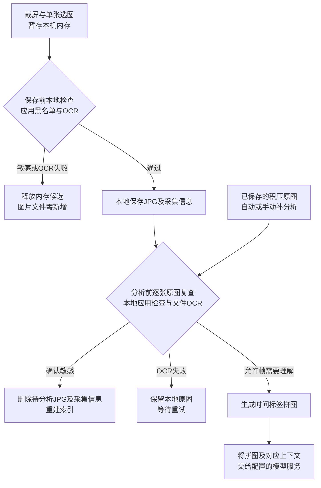
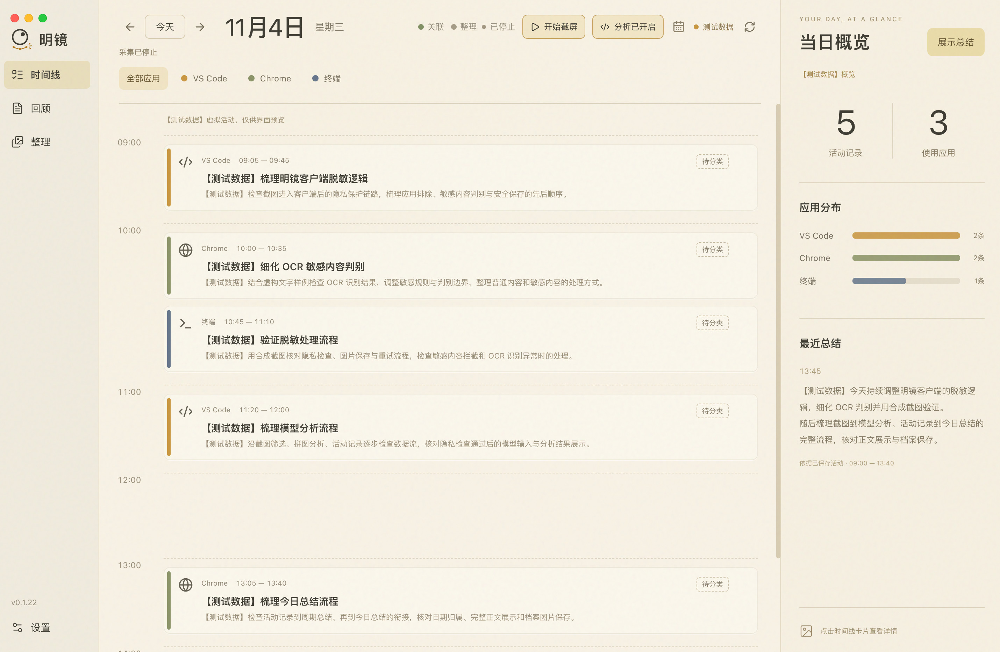
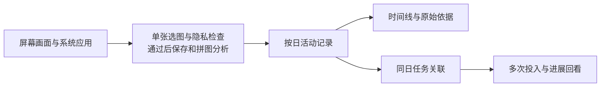
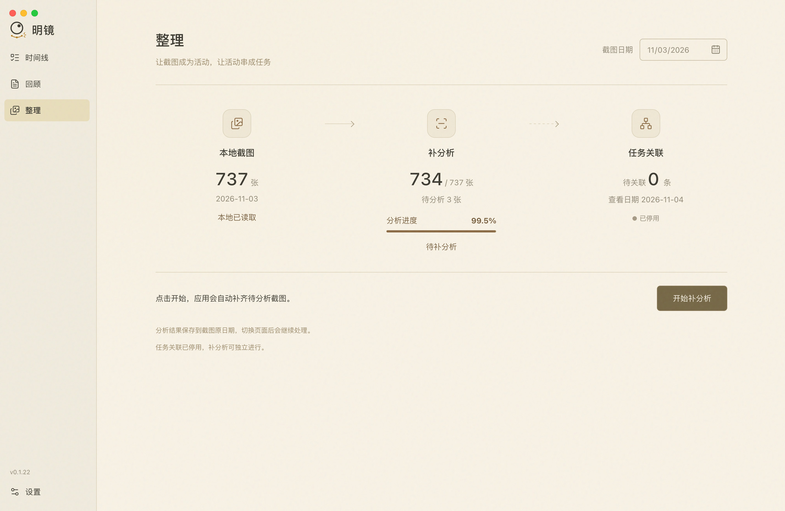

# x-scening

**感知屏幕，沉淀时间线，分析任务关联。**

x-scening 是一个面向 macOS 的被动式屏幕感知系统：持续观察电脑上的可见操作，把画面转成活动记录，再把一天中围绕同一目标的活动关联起来，形成可回看的任务过程。

在浏览器查资料、到编辑器改代码、回到聊天窗口核对方案——这些分散在不同应用里的操作，可以沿着同一件事重新串起来。

[隐私与数据流](#隐私与数据流) · [功能](#能做什么) · [本地运行](#本地运行) · [数据与控制](#数据与控制) · [流程与验证索引](#开发文档)

## 隐私与数据流

**每张待保存截图先在本机内存中做隐私检查，通过后保存；分析前再逐张检查原图，通过的画面才参与拼图和模型分析。** 应用黑名单与系统Vision OCR在本机执行，项目当前默认配置已开启两处隐私检查。



图按隐私OCR及分析均开启描述，实时新图默认凑齐3张再逐图复查；积压尾批支持1～2张。符合无变化复用条件时只延长活动时间，需要理解时才生成拼图。两次OCR都处理单张原图。

| 用户关心的情况 | 当前处理 |
| --- | --- |
| 密钥、密码或其他敏感文字出现在画面上 | 先做应用黑名单检查，再按OCR文本匹配密钥前缀、凭证标签、长混合字符、卡号及身份证等规则；实时命中释放内存，已保存的待分析原图命中后删除图片和采集信息。 |
| OCR执行失败或检查期间退出 | 实时保存前的错误/停止保持图片零新增；已保存原图的检查失败或取消保留文件，供重试继续。 |
| 数据保存在哪里、何时交给模型 | 原图和记录保存在本地；图片分析及手动补分析会把允许帧生成的拼图与对应上下文交给配置的模型，任务整理和总结会使用相应文字上下文。 |
| 如何控制采集和检查 | 客户端分别提供截屏与分析开关；`observer.yaml`的`privacy.enabled`、`ocrEnabled`及应用名单控制隐私检查。每张JPG旁的`.metadata.json`保存截图时间、屏幕、应用身份等采集信息。 |

检测依赖当前OCR和文本规则；OCR识别为零行时按现有策略放行。规则覆盖、配置生效时机和当前边界见[隐私判定规则](docs/design/screenshot-sensitive-rules-20261101.md#10-接入契约与当前落地状态)及[配置说明](src/scening/README.md#配置与数据)。

隐私链路已有[真实截图E2E与回放验证](reports/memory-ocr-e2e-20261104/test-report.md)：普通页在OCR后保存，合成密钥页在判定前后保持零图片；该次验证范围为单张截图、保存前OCR及文件结果。[测试图片、实录日志与复跑方法](tests/fixtures/memory_ocr_native/README.md)均可查阅，完整流程及后续拼图验证入口见下方[文档索引](#开发文档)。



*v0.1.22客户端截图（2026-11-04）：时间线与当日概览，使用【测试数据】预览。*

## 能做什么

| 能力 | 记录什么 | 帮你看见什么 |
| --- | --- | --- |
| **感知屏幕** | 多屏画面中的操作、发生时间和系统应用信息 | 当时在看什么、做什么，以及对应的原始截图 |
| **沉淀时间线** | 按日期保存的活动片段、周期总结和每日回顾 | 一天经历了哪些切换，每件事在什么时候发生 |
| **分析任务关联** | 同一天围绕相同对象和目标的多次活动 | 同一任务在不同应用、不同时间的投入，以及有依据的进展 |

- **回到具体过程**：点击时间线卡片查看详情，从任务的某次投入跳回相应活动；详情中的全天时间条支持点击定位。
- **补齐积压截图**：开启分析后先处理当天最早未分析的截图；独立“补分析”页面支持指定今天或历史日期，开始、停止和继续，棕色进度条按已分析数量更新。
- **保留原始依据**：活动保存原图引用和采集信息，关联结果可以回看来源；证据不足的归属保留为“待关联”。
- **按需控制**：分别控制截屏与分析，在设置中调整截图节奏、分析参数和任务类型。

## 从画面到任务



例如，上午在浏览器排查登录问题，随后在编辑器修改，下午继续验证结果：三次活动保留各自的时间位置，同时可以关联到“修复登录”这项任务。新的明确目标形成新任务，已有任务通过相同对象和目标继续承接后续活动。

任务关联依据屏幕可见内容和已有记录生成；任务完成情况由用户判断。时长有连续采样依据时显示估算，单次观察和记录空白保留“待确认”。当前任务关联范围为**同一天**。

## 本地运行

当前采集链路面向 **macOS**。桌面客户端使用 Electron、React 和 TypeScript，采集与记录使用 Python；分析通过外部 **KMH 的 `scening` profile** 调用模型。

### 1. 准备环境

准备 Python 3.9+、Node.js 22.12+ 或 24+，以及系统可用的 `npm`，然后在终端执行：

```sh
git clone https://github.com/KtKID/x-scening.git
cd x-scening

python3 -m venv .venv
.venv/bin/python -m pip install -r requirements.txt
```

macOS 采集需要授予屏幕录制权限，键鼠监听需要相应的输入监控或辅助功能权限。首次运行时按系统提示授权。

### 2. 配置分析环境

图片分析、任务整理和总结使用基于 DeepSeek Harness 插件打包的内置 Agent 运行时。源码运行前执行 `node desktop/scripts/prepare-kmh.mjs` 准备固定快照，默认启动器和插件组合见 [公开模板](observer.yaml)。开发环境的个人参数保存在 `observer_dev.yaml`。

当前默认分析配置为 MiniMax 中国区 `MiniMax-M3`。凭据填写在本机的 `home/kmh/.env`，配置方法、profile 来源与运行目录见 [KMH 配置说明](src/scening/README.md#kmh-configuration)。本仓库保留 KMH 调用适配，外部 KMH 环境需要单独准备。

### 3. 启动桌面客户端

```sh
desktop/scripts/run.sh ci
desktop/scripts/run.sh run setup:electron
./desktop/run.sh
```

进入客户端后，点击“开始截屏”，通过“开启分析”选择是否同步生成活动与总结。开启分析会先补当天积压，再处理新截图；“补分析”页面可以单独补齐指定日期。

也可以从项目根直接运行采集程序：

```sh
# 采集并分析
./run.sh

# 仅保存截图
./run.sh --capture-only
```

桌面启动、平台边界与构建方式见 [桌面客户端说明](desktop/README.md)；采集参数、CLI 和保存流程见 [感知模块说明](src/scening/README.md)。

## 数据与控制

本地打包测试默认使用`dev`模式。GitHub Release或tag环境的构建自动采用`publish`模式，默认数据根为`~/.scening`，配置保存在`~/.scening/observer.yaml`，截图保存在`~/.scening/snapshots`；已有用户配置持续保留。发布构建只使用公开模板 [observer.yaml](observer.yaml)。开发客户端首次启动生成个人配置 `observer_dev.yaml`，该文件由 Git 忽略。构建命令和覆盖方式见[构建模式说明](desktop/README.md#构建模式与数据目录)。

原始截图和结构化记录保存在本地，下表列出开发模式默认位置；路径和运行节奏统一由所选配置管理。

| 内容 | 默认位置 |
| --- | --- |
| 按日期保存的JPG、采集信息metadata与分析索引 | `data/snapshot-v1/YYYY-MM-DD/` |
| 活动记录及原图引用 | `home/records/YYYY-MM-DD.json` |
| 同日任务、关联和进展 | `home/task-timeline/YYYY-MM-DD.json` |
| 周期总结 / 每日回顾 | `home/summaries/` / `home/daily-reviews/` |
| 模型运行数据 / 运行日志 | `home/kmh/` / `logs/` |

执行图片分析或手动补分析时，允许帧生成的拼图及相应文字上下文发送给配置的模型服务。常规仅截屏流程在本地隐私检查通过后保存原图；关闭实时分析会取消该通道当前任务，已经保存的结果继续保留，手动补分析沿独立任务控制。检查顺序及失败处理见上方[隐私与数据流](#隐私与数据流)。



*v0.1.22客户端截图（2026-11-04）：整理页采用“本地截图 → 补分析 → 任务关联”三节点布局，展示截图数量、分析进度与任务关联状态。*

每一天的完成情况由原图和成功报告共同核对，索引可以重建；重新补分析会跳过已经成功保存的原图。细节见 [截图分析索引](docs/spec/screenshot-analysis-status/spec.md) 与 [按日期补分析](docs/spec/screenshot-analysis-backfill/spec.md)。

## 开发文档

| 入口 | 内容 |
| --- | --- |
| [项目文档总览](docs/README.md) | 模块导航、数据路径与相关资料 |
| [截图、OCR与拼图专题索引](docs/README.md#screenshot-ocr-docs) | 全部相关流程文档、实施任务、benchmark、真实E2E、日志与测试图片 |
| [隐私判定规则](docs/design/screenshot-sensitive-rules-20261101.md) | 两处本地检查、应用名单、敏感文字规则、删除与失败重试策略 |
| [屏幕感知P0 Spec](docs/spec/screen-observer-p0/spec.md#formal-images)、[技术设计与完整时序](docs/spec/screen-observer-p0/tech-design.md#runtime) | 单张选图、内存OCR、文件OCR、原图保存与三帧拼图的需求及实现顺序 |
| [内存OCR实施任务](docs/spec/screen-observer-p0/tasks/task-memory-ocr.md) | 实施方案、测试用例、性能测量和真实E2E的覆盖边界 |
| [补分析Spec](docs/spec/screenshot-analysis-backfill/spec.md)、[当天队列任务](docs/spec/screenshot-analysis-backfill/tasks/task-today-analysis-queue.md) | 自动积压、手动补分析、当日新图、同日锁及逐张隐私复查 |
| [三帧拼接分析任务](docs/spec/screen-observer-p0/tasks/task-three-frame-analysis.md) | 凑批、时间标签拼图、模型调用和原图保留的实施与验证 |
| [内存OCR测试与benchmark](reports/memory-ocr-20261104/test-report.md) | 文件状态断言、耗时、内存与缓存压力数据 |
| [真实截图E2E与日志回放](reports/memory-ocr-e2e-20261104/test-report.md)、[积压隐私验证](reports/fix/privacy-backlog-20261104/test-report.md) | 真实允许/拦截路径、日志冻结样本及自动/手动积压检查 |
| [测试样本说明](tests/fixtures/memory_ocr_native/README.md)、[普通页](tests/fixtures/memory_ocr_native/allowed.png)、[合成密钥页](tests/fixtures/memory_ocr_native/sensitive.png) | 实际录制的测试图片、回放方式和中文用例说明 |
| [固定回放数据](tests/fixtures/memory_ocr_native/recording.json)、[阶段日志](tests/fixtures/memory_ocr_native/events.jsonl) | 实际OCR分词、输入哈希、配置和文件事件 |
| [内存OCR测试](tests/test_memory_ocr.py)、[实录回放测试](tests/test_memory_ocr_replay.py)、[真实录制脚本](scripts/verify_memory_ocr_e2e.py) | 运行测试、真实取屏及从日志重新导出夹具 |
| [流程文档同步检查](reports/docs-ocr-flow-20261104/test-report.md) | 流程图与文字说明的同步核对记录 |
| [Python 感知模块](src/scening/README.md) | 采集、图片分析、记录、总结与任务整理 |
| [桌面客户端](desktop/README.md) | 页面、采集控制、设置、检查与打包 |
| [任务关联时间线](docs/spec/task-linked-timeline-mvp/spec.md) | 同日任务、进展、投入片段与定位回看 |
| [公开发布模板](observer.yaml) | 带中文注释的公开运行默认值 |
| [项目规划](docs/project-plan.md) | 产品背景、当前范围与后续方向 |

常用开发检查：

```sh
PYTHONPATH=src:tests .venv/bin/python -B -m unittest discover -s tests -v
desktop/scripts/run.sh run check
desktop/scripts/run.sh test
desktop/scripts/run.sh run build
```

当前处于 P0/MVP 持续验证阶段，重点是采集、理解、保存与回看的完整流程。后续方向包括跨日任务连续性、浏览器上下文增强和基于活动记忆的主动协助。

## 自动打包发布

推送与源码版本一致的`v`标签（例如`v0.2.0`），GitHub Actions会构建macOS Apple Silicon客户端，明确使用`publish`模式，核对实际包的模式、版本、架构和Logo后发布Release附件。手动运行默认仅验证候选包。版本准备和命令见[GitHub Release说明](desktop/README.md#github-release)，运行结果见[Actions](https://github.com/KtKID/x-scening/actions/workflows/release.yml)。

## 许可证

本项目原创代码采用 [MIT License](LICENSE)，允许商业使用、修改、分发和销售，相关副本须保留版权与许可声明。

第三方代码、依赖和参考副本分别遵循各自的许可证，相关版权及许可声明随对应文件保留。

## 灵感来源与致谢

x-scening 的产品构想受到以下项目的启发：

- [Dayflow](https://github.com/JerryZLiu/Dayflow)：将屏幕活动整理为每日时间线的思路。上游采用 [MIT License](https://github.com/JerryZLiu/Dayflow/blob/main/LICENSE)。
- [Coco](https://github.com/collaborative-agents/coco)：持续感知电脑使用上下文，为主动式协助提供基础的思路。上游采用 [Apache License 2.0](https://github.com/collaborative-agents/coco/blob/main/LICENSE)。
