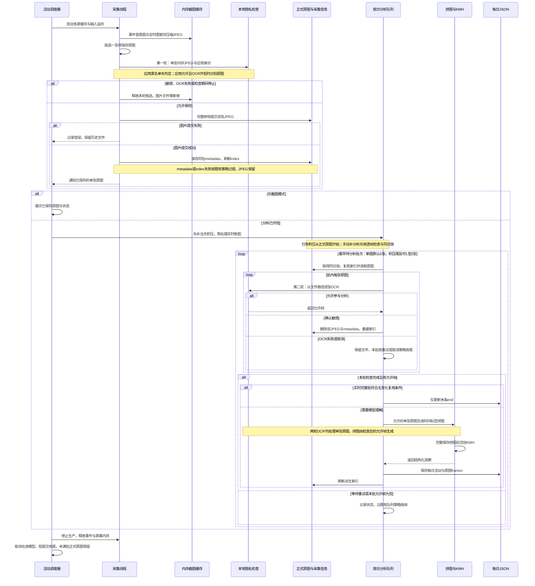
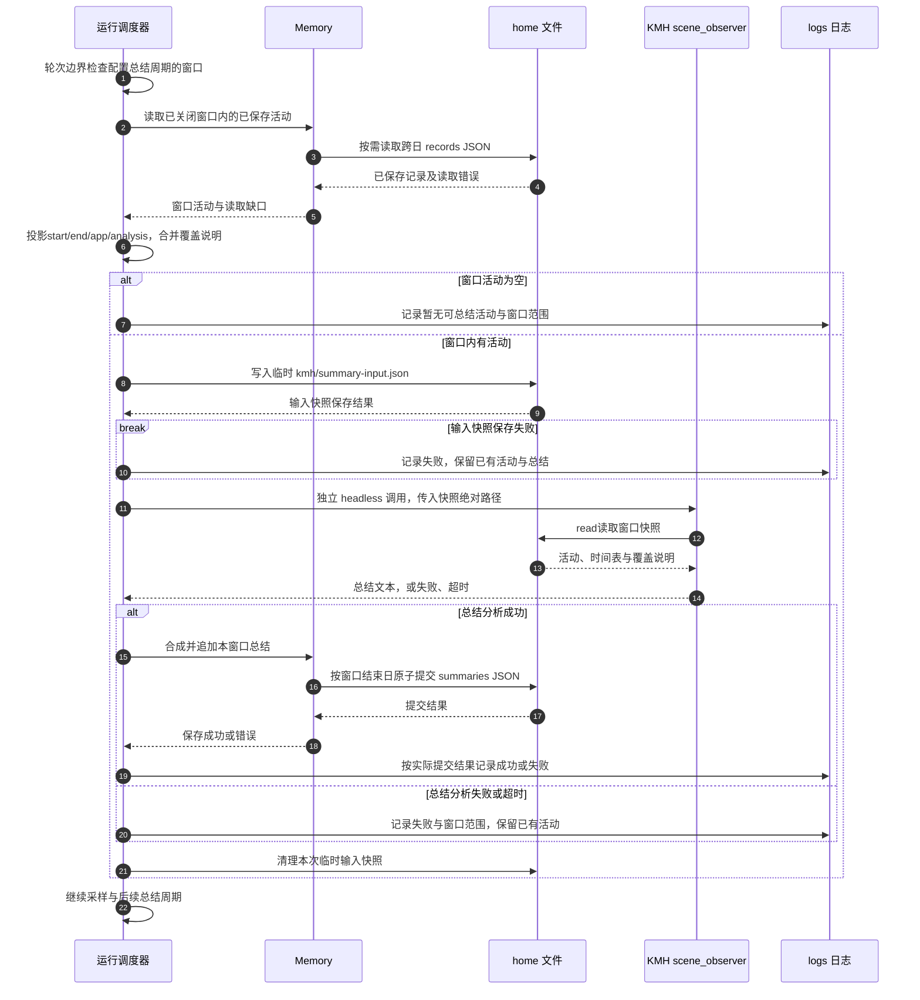
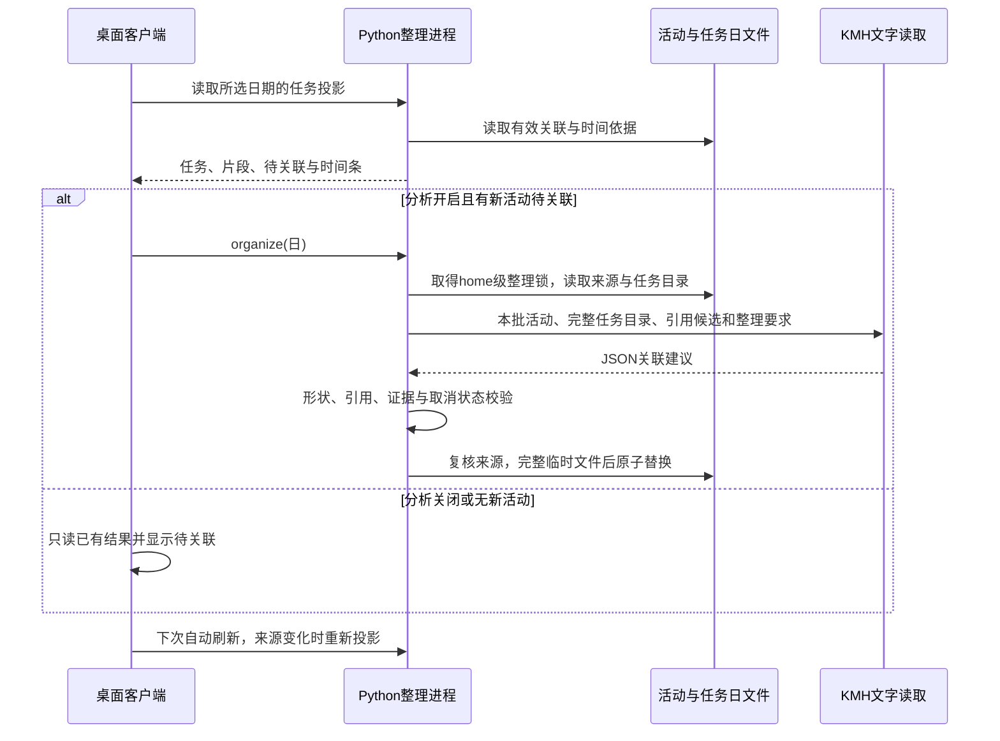

# x-Scening 项目文档

[项目首页：感知屏幕，沉淀时间线，分析任务关联](../README.md)

x-Scening 在 macOS 后台选取屏幕画面，保存活动、周期总结和每日回顾，并在桌面时间线中关联当天任务与进展。本仓库还保留浏览器扩展补丁和研究交付资料。项目目标、阶段与开发约束见[项目入口](../AGENTS.md)，整体方向见[项目规划](project-plan.md)。

阅读顺序：项目入口 → 本总览 → 模块目录内的说明 → 源码与 Spec。各模块的使用、设计、代码与 Spec 关系在就地 README 中维护。

## 模块索引

按本仓库当前模块边界，索引覆盖感知系统、桌面客户端、浏览器自定义模型扩展及其独立补丁子模块。`src/scening/` 内的采集、分析、存储与任务整理统一由该目录 README 说明；桌面内部入口及开发脚本按所属模块查阅。研究交付副本、迁出模块、第三方参考和构建产物的入口集中在下方“迁出与研究资料”。

| 模块目录 | 功能简介 | 说明文档 |
| --- | --- | --- |
| `src/scening/` | 多屏画面经单张内存OCR后保存JPEG，分析前逐张文件OCR，默认三帧拼图理解；按日保存活动、总结与每日回顾，提供截图索引及同日任务关联。 | [Python 感知系统：功能、用法、代码与 Spec](../src/scening/README.md)（草稿） |
| `desktop/` | Electron + React + TypeScript 黄纸底时间线，读取本地活动、任务片段与进展，提供概览、详情、每日回顾、采集启停、分析开关与完整设置。 | [桌面客户端](../desktop/README.md) |
| `desktop/src/version-check/` | 构建并发布固定入口的本机客户端，检测已就绪版本，安全收尾后一键重启切换。 | [本机构建、更新提示与一键重启](../desktop/src/version-check/README.md)（草稿） |
| `browser/kimi-custom-provider-v2/` | 提供侧栏 Agent 对话、网页阅读与操作、附件、会话历史、技能、操作录制、划词和本地 Agent 连接；v2 增加自定义模型设置。 | [完整功能与代码说明](../browser/kimi-custom-provider-v2/README.md)（草稿） |
| `browser/kimi-custom-provider-v2/patch-source/` | 为指定原版生成自定义模型补丁，提供配置校验、保存与停用组件，以及独立静态/模拟测试。 | [补丁模块说明](../browser/kimi-custom-provider-v2/patch-source/README.zh-CN.md)（模块说明草稿，保留原交付记录） |

当前索引：**5/5个模块已有readme并被索引，0个模块readme待补，4份说明带草稿标记。** 草稿为scening、本机构建更新、Kimi自定义模型扩展及补丁子模块。目录与文件名按2026-11-04本地状态核对；录制夹具作为scening测试资料在下方专题索引维护，迁出/历史交付模块另列。

## 快速查阅

| 想了解什么 | 文档入口 |
| --- | --- |
| 采集、总结、任务关联的完整流程图 | [本页《核心流程图》](#核心流程图) |
| 保存前怎样拦截敏感画面、哪些数据交给模型 | [根目录README：隐私与数据流](../README.md#隐私与数据流) |
| 单张选图、两轮OCR、积压、拼图及全部相关证据 | [截图、OCR与拼图文档索引](#screenshot-ocr-docs) |
| 如何启动、停止，或只保存截图 | [感知系统：启动与停止](../src/scening/README.md#启动与停止) |
| 20 秒操作选图、5 秒候选处理等参数的含义 | [截图与分析的节奏](../src/scening/README.md#截图与分析的节奏) |
| 原图、拼图、报告、索引、总结、日志保存在哪里 | [数据目录与文件路径](../src/scening/README.md#数据目录与文件路径) |
| 图片资源占用了多少空间 | [带统计时间的图片空间快照](../src/scening/README.md#图片空间占用快照) |
| 采集到分析的代码怎样配合，关键函数在哪里 | [scening代码与关键函数索引](../src/scening/README.md#代码说明) |
| 感知模块由哪些需求构建，哪些能力仍在规划 | [scening Spec 索引](../src/scening/README.md#spec-索引) |
| 如何启动桌面应用、编辑设置和查看任务 | [桌面客户端说明](../desktop/README.md) |
| 如何填写 KMH 模型凭据及核对调用方式 | [KMH 配置](../src/scening/README.md#kmh-configuration) |

旧版 `home/screenshot/` 已由用户删除；历史路径、当前目录状态与占用统计集中保留在 scening 的路径说明中。占用数字随采集变化，查阅时以快照标注的时间为准。

## 截图、OCR与拼图文档索引

按2026-11-04当前流程汇总：模块详细说明见scening自身README，需求与设计分别查Spec/技术设计，实施记录、验证报告和固定样本按下表进入。

### 流程与设计

| 入口 | 查阅内容 |
|------|----------|
| [scening模块README](../src/scening/README.md) | 采集、选图、两轮OCR、保存与分析的模块说明，配置、文件路径、代码和Spec索引。 |
| [本页主链路时序图](#核心流程图) | 单张选图→内存OCR→保存→逐张文件OCR→需要理解时拼图分析，含主要错误分支。 |
| [项目规划：核心链路](project-plan.md#31-核心链路) | 产品级流程、模块协作与后续方向。 |
| [屏幕感知P0 Spec](spec/screen-observer-p0/spec.md#formal-images) | feat02、feat09场景1/8/10及C8/C9，定义单张原图检查、保存与拼图顺序。 |
| [屏幕感知技术设计](spec/screen-observer-p0/tech-design.md#runtime) | D01完整时序及D03图片提交，标明两处检查入口、队列归属与文件副作用。 |
| [截图敏感判定规则](design/screenshot-sensitive-rules-20261101.md#10-接入契约与当前落地状态) | 实时内存/分析文件两入口、L0应用与L2内容规则、敏感删除和OCR失败重试。 |
| [按日期补分析Spec](spec/screenshot-analysis-backfill/spec.md) | 今天/历史日期补分析、允许帧入批、敏感清理、取消继续与尾批。 |
| [当天截图统一队列任务](spec/screenshot-analysis-backfill/tasks/task-today-analysis-queue.md) | 当天积压优先、实时新图满批、同日锁、逐图文件OCR与采集信息恢复。 |
| [实时内存OCR实施任务](spec/screen-observer-p0/tasks/task-memory-ocr.md) | D1–D5、T1–T10、内存缓存和原生OCR方案、benchmark、真实E2E及覆盖边界。 |
| [三帧拼接分析任务](spec/screen-observer-p0/tasks/task-three-frame-analysis.md) | 凑批、时间标签拼图、模型调用和原图保留的实施与验证记录。 |
| [截图分析状态Spec](spec/screenshot-analysis-status/spec.md)、[恢复方案](design/screenshot-analysis-recovery-plan.md) | 报告frames作为成功真源，按日索引重建与历史方案依据；当前执行以补分析Spec为准。 |

### 实施、验证与测试样本

| 入口 | 证据与使用边界 |
|------|----------------|
| [内存OCR测试与benchmark报告](../reports/memory-ocr-20261104/test-report.md) | 内存OCR、退出及保存断言、145项当批测试、耗时/RSS/缓存占用；含[benchmark脚本](../reports/memory-ocr-20261104/evidence/benchmark.py)和[原始结果](../reports/memory-ocr-20261104/evidence/benchmark.json)。 |
| [真实截图E2E与日志回放报告](../reports/memory-ocr-e2e-20261104/test-report.md) | 单张实际MSS截图→真实Vision→JPEG/metadata保存，允许/敏感2/2、回放5/5及相关回归42/42；后续拼图和KMH沿对应记录核对。 |
| [实录夹具README](../tests/fixtures/memory_ocr_native/README.md) | 实际截图与OCR返回怎样供mock消费、预期与实录结果的区分、录制和回放方法。 |
| [普通页截图](../tests/fixtures/memory_ocr_native/allowed.png)、[合成密钥页截图](../tests/fixtures/memory_ocr_native/sensitive.png) | 两张2560×1440受控页面真实截图，分别用于允许保存与敏感拦截回放。 |
| [回放数据](../tests/fixtures/memory_ocr_native/recording.json)、[固定阶段日志](../tests/fixtures/memory_ocr_native/events.jsonl)、[E2E阶段实录](../reports/memory-ocr-e2e-20261104/evidence/native-events.jsonl) | 固定配置、采集像素哈希、真实OCR分词和文件事件；支持从阶段日志重新导出并核验夹具。 |
| [内存OCR测试](../tests/test_memory_ocr.py)、[实录回放测试](../tests/test_memory_ocr_replay.py) | 带中文测试内容和预期说明，核对OCR前后实际目录、保存字节、拦截、异常与退出。 |
| [采集回归](../tests/test_scening.py)、[敏感闸门测试](../tests/test_sensitive_guard.py) | 事件首尾及缓存上限、真实Vision和既有敏感规则测试。 |
| [真实E2E及夹具导出脚本](../scripts/verify_memory_ocr_e2e.py) | 显示受控页面并真实取屏，或以`--export-only`从已录日志导出固定样本。 |
| [积压隐私测试报告](../reports/fix/privacy-backlog-20261104/test-report.md) | 自动积压/手动补分析共用判定、敏感图及metadata删除、OCR失败保留重试。 |
| [流程文档同步检查](../reports/docs-ocr-flow-20261104/test-report.md) | 9份流程文档、5处图、链接与调用顺序的静态检查。 |
| [OCR退出残留调查（修复前）](../reports/cr/cr-report-20261104-130916-ocr-exit.md) | 旧文件OCR与强制退出残留的历史取证；当前方案与修复见内存OCR实施任务。 |

## 模块协作

`run.sh`启动scening，后台刷新多屏缓存，操作与定时两路各挑选单张原图，在内存中完成第一轮隐私OCR，通过后保存JPEG及采集信息。分析队列先补当天积压，再按批读取新图；每张原图经文件OCR复查，通过后参与比较，需要理解时再生成拼图并调用KMH。活动写入日文件，再补存采样依据和刷新截图索引。周期总结汇总已保存活动，每日回顾汇总同日活动及周期总结；保存顺序见[scening说明](../src/scening/README.md)，时序见下节。

桌面客户端读取上述日文件和图片，通过本地控制通道启停采集、切换分析；同日任务整理生成独立关联与进展，统一时间投影为任务片段、观察时点和估算投入。正式记录由 Python 写入，桌面配置编辑和展示边界见 [桌面说明](../desktop/README.md)。

扩展侧栏把消息、附件和所选网页交给后台 Agent；后台调用模型，再按需要执行浏览器工具，将进度和结果回传侧栏并保存本地会话。补丁模块维护模型连接和设置的替换代码；本地 Agent 经单独的桥接服务连接扩展，调用同一套底层浏览器工具。

## 核心流程图

全局流程总览，三张时序图分别覆盖采集到活动记录主链路、半小时总结与同日任务关联；决策依据与分支细节见 [屏幕感知技术设计](spec/screen-observer-p0/tech-design.md) 与 [任务时间线技术设计](spec/task-linked-timeline-mvp/tech-design.md)，本节与两者同步维护。

### 采集 → 隐私闸门 → 活动记录（主链路）

“挑选单张原图”表示从内存截图中选出一张准备保存的画面：事件路径取分段后的末条操作结束图，定时路径取选中屏幕的当前缓存图。“正式候选”是通过隐私检查并保存后的这张JPEG；三帧拼接由后续分析阶段完成。

开启隐私OCR与分析时，实时新图通常经过两轮检查：**单张内存图OCR→允许后保存→默认凑齐3张→逐张文件OCR→允许帧比较→需要理解时拼图→模型分析**。自动积压及手动补分析从已保存原图的逐张文件OCR开始；积压尾批支持1～2张。

两轮OCR都检查单张原始分辨率JPEG。采集端敏感命中或OCR失败时释放内存候选；分析端确认敏感后删除已保存JPEG及同名metadata，OCR失败则保留文件重试。每张正式图对应`xxx.jpg`及`xxx.jpg.metadata.json`，后者保存采集时间、屏幕、应用与连续性信息；按日`index.json`由报告和原图重建。应用黑名单优先于OCR，隐私/OCR开关按配置生效；规则见[敏感判定说明](design/screenshot-sensitive-rules-20261101.md)。

本轮[真实E2E与固定回放](../reports/memory-ocr-e2e-20261104/test-report.md)覆盖“单张实际截图→内存OCR→检查JPEG及metadata保存结果”；三帧拼图与模型调用沿各自测试和真实验证记录核对。2026-11-04流程说明与上图已按当前调用顺序同步。

### 半小时总结（独立流程）

总结只读取已保存活动生成文字时间表，不回写活动记录；跨午夜窗口按窗口结束日归属文件。

### 同日任务关联（独立流程）

任务关联只读已保存活动并生成独立关联文件，不修改活动记录；分析关闭时停止整理、保留已有结果。

## 迁出与研究资料

这些目录提供迁出导航、来源核对或历史交付材料，按各自说明查阅。

| 目录或资料 | 用途与状态 | 说明入口 |
| --- | --- | --- |
| `browser/kmh-extension-ts/` | TS 扩展代码已迁往独立的 km-browser-agent 仓库，本目录保留迁出说明与 `dist` 兼容软链接；开发与提交在新仓库进行。 | [迁出说明与新仓库入口](../browser/kmh-extension-ts/README.md) |
| `browser/kmh-browser-source/` | 浏览器执行层的历史可编辑源码交付包，包含 TypeScript 执行库、同步脚本和手动验证壳；能力及验收范围沿原交付说明。 | [源码包说明](../browser/kmh-browser-source/README.md)、[执行库](../browser/kmh-browser-source/kimi-browser-executor-ts/README.md)、[手动验证壳](../browser/kmh-browser-source/kimi-browser-executor-manual-qa/README.txt) |
| `browser/kmh-browser/` | 执行层手动测试壳的已打包交付副本，按其实际测试报告核对结果。 | [测试壳使用说明](../browser/kmh-browser/README.txt) |
| `docs/task/archived-sensing/` | 本地研究归档，保留感知参考源码、许可证和来源清单；正式应用入口为 `src/scening/`。 | [来源与边界](task/archived-sensing/SOURCE.md)、[参考包说明](task/archived-sensing/README.md) |
| Nanobrowser 历史构建 | 保留 2026-10-26 构建与用户可用反馈；2026-10-30 复查时原 `nanobrowser/` 目录已不存在。 | [进度、历史路径与环境记录](nanobrowser-progress-and-environment.md) |

## 相关文档

| 文档 | 用途 |
| --- | --- |
| [任务时间线 MVP Spec](spec/task-linked-timeline-mvp/spec.md)、[技术设计](spec/task-linked-timeline-mvp/tech-design.md) | Spec v1.0 已确认：5 个功能覆盖同日任务关联、时间线优化、进展详情、点击定位与详情全天时间条；技术设计 v1.0 已确认，MVP链路已接通，包含稳定任务身份与配色、独立文字整理及连续采样依据。 |
| [每日自动总结与次日阅读 Spec](spec/daily-review-automation/spec.md)、[技术设计](spec/daily-review-automation/tech-design.md) | Spec v1.1按用户补充更新：日期/时间选择组件、已结束日期的部分分析补总结、居中总结按钮与动态日期提示；默认次日03:00、独立运行与完整失败原因。3个功能、10个场景；技术设计v1.0已确认并实施，开发与执行边界见[任务报告](spec/daily-review-automation/tasks/task-daily-review-automation/dev-report.md)。 |
| [Python 感知实现](../src/scening/README.md) | 当前活动入口使用 `src/scening/` 的多屏采集、选屏、选图与 JPEG，KMH、每日记录和总结沿用。 |
| [KMH专用工具接入](spec/screen-observer-p0/tasks/task-scening-profile.md)、[原工具交接](handoff/scene-observer-profile-tools.md) | 默认scening；图片通过read_image与submit_observation提交三个内容字段及软件标签，总结使用read；接入与真实拼图验证见task。 |
| [任务类型预设](spec/screen-observer-p0/tasks/task-type-presets.md)、[插件多选类型需求](handoff/scene-observer-task-types.md) | 设置中维护类型候选并保存配置、发送分析提示；多选结果的工具参数、卡片及总结接入交接。 |
| [TS/TSX 重建方案](browser-extension-ts-reconstruction-plan.md) | 扩展独立重建的历史范围与流程；后续开发位置见上方迁出说明。 |
| [浏览器扩展接入评估](research/kmh-browser-typescript-integration-2026-10-26.md) | 工具、存储、通信和后续 KMH 接入的源码调查。 |
| [浏览器行为对齐任务](task/task-browser-extension-parity.md) | 独立 TS 工程的实现对应、构建证据与待验证差异。 |
| [KMH agent 内核任务](task/task-agent-kernel-dsh.md) | KMH（DSH harness）的 agent 循环打包进扩展为可选引擎的方案、验证与边界；kongming-os 零改动。 |
| [Nanobrowser 进度与环境](nanobrowser-progress-and-environment.md) | 历史网页侧栏扩展的安装、环境与已有验证记录，原目录现状见上方“迁出与研究资料”。 |

当前运行配置：[observer.yaml](../observer.yaml)，全部可调数值附中文原生注释；迁移与验证见 [YAML配置task](spec/screen-observer-p0/tasks/task-yaml-config.md)。

截图目录在 observer.yaml 中配置 `screenshotDir`，默认项目 `data/snapshot-v1`；完整路径、按日期保存规则和历史目录状态见 [scening 路径表](../src/scening/README.md#数据目录与文件路径)，实现与验证见[截图目录 task](spec/screen-observer-p0/tasks/task-snapshot-path.md)。

- [每日温馨回顾](spec/screen-observer-p0/tasks/task-daily-review.md)：当日概览总结按钮、多时间段汇总、回复后遮罩弹窗与独立按日保存。

## 待补与待确认

当前5个模块的就地说明均已建立。scening、本机构建更新与两份扩展说明共4份草稿等待用户检查；scening的全局截图冷却需求和数值选择依据，沿[模块待确认项](../src/scening/README.md#待确认)继续核对。

Kimi 扩展的原始功能 Spec 和原版设计决策来源待确认。功能清单依据本地程序静态核对；真实浏览器、模型、录制与本地桥接运行结果在模块说明中列为待验证。Nanobrowser 的历史构建文档保留原交付依据，其原源码路径已缺失；后续使用前核对实际位置。
