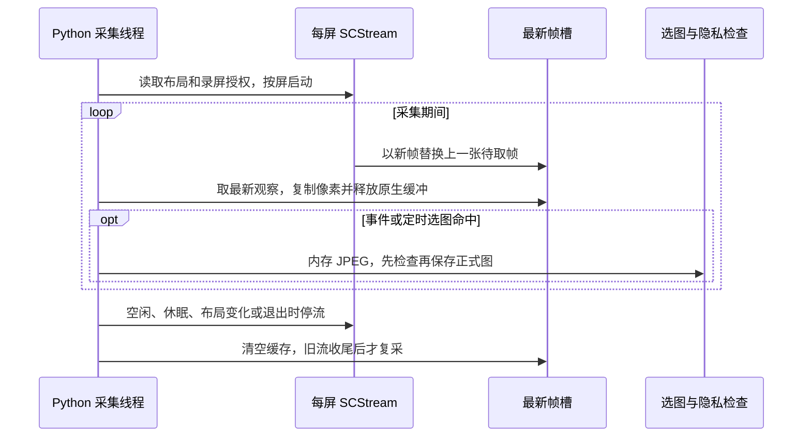

# scening：x-scening 的 Python 感知系统

> 草稿，待用户检查。更新日期：2026-11-04。

## 功能描述

本模块在 macOS 后台选取屏幕画面，保存原图与带采集时间的活动，并按周期生成总结；桌面客户端可查看记录、每日回顾和同日任务进展。应用代码统一位于本目录，按用户指定保留 `scening` 拼写。

```text
ScreenCaptureKit 多屏最新帧缓存 ── 键鼠事件首尾（内存JPEG）── 差异分段 / 末条结束图
          └──────── 独立定时观察与选屏 ────────────┘
                              ↓
                    挑选一张待保存原图
                              ↓
           第一轮隐私检查：应用黑名单 + 单张内存OCR
                              ↓
              允许后保存单张JPEG + 同名metadata → 刷新index
                              ↓
           实时默认凑齐3张 / 积压尾批1至2张 → 逐张文件OCR
                              ↓
          允许帧比较 → 无变化按规则延长end / 需要理解时拼图KMH → 每日JSON → 总结
```

本模块还提供独立每日回顾、按日截图分析清单，以及同日任务关联和时间投入投影。桌面客户端通过已有文件、日志和本地控制入口展示结果；代码范围见“代码说明”。

“挑选一张待保存原图”在事件路径取分段后的末条操作结束图，在定时路径取目标屏当前缓存帧。三帧拼接由后续分析负责；两轮OCR均检查单张原始分辨率JPEG。实时新图、自动积压及手动补分析共用文件逐图检查，积压从已保存原图开始。隐私/OCR及分析开启时，实时新图进入两个入口通常累计检查两次；完整时序见[项目流程图](../../docs/README.md#核心流程图)。

## 设计理念

采集、理解、记录分别承担抓到画面、解释画面、保存证据三个职责。采集线程持续更新屏幕缓存，主线程顺序处理候选与模型调用，让慢分析期间仍能收集后续画面；队列上限控制积压，过载和中断进入日志。依据：[模块职责](../../AGENTS.md#模块职责)。

单张原图在内存中通过隐私OCR后保存，实时默认凑满三张，再逐张做文件OCR；允许帧需要理解时保存时间标签拼图，随后调用模型并提交活动。正式原图与已提交拼图在模型失败后保留，可用于回看证据；保留策略增加磁盘占用。依据：[P0 C8/C9](../../docs/spec/screen-observer-p0/spec.md#关键约束用户已确认)、[三帧局部设计](../../docs/spec/screen-observer-p0/tasks/task-three-frame-analysis.md)。

活动报告记录正式分析结果，索引按报告的 frames 与现存原图重新计算；任务关联、采样依据和每日回顾分别保存，原观察保留自己的写入职责。代价是读取展示时需要复核多个文件的版本。依据：[截图索引](../../docs/spec/screenshot-analysis-status/spec.md)、[任务存储设计](../../docs/spec/task-linked-timeline-mvp/tech-design.md#task-storage)。

配置默认值集中在 YAML，程序启动时通过 Pydantic（字段与数值校验工具）生成本轮固定配置；保存时采用先写完整临时文件、再一次替换目标的方式。这样可以在参数错误或文件提交失败时保留已有数据；采集参数在下一次开始采集时生效。依据：[配置任务](../../docs/spec/screen-observer-p0/tasks/task-yaml-config.md)、[设置任务](../../docs/spec/screen-observer-p0/tasks/task-settings.md)。

## 使用方式

### 启动与停止

项目虚拟环境安装 `requirements.txt` 后，在项目根启动：

```sh
./run.sh
./run.sh --capture-only --count 2 --home ./tmp/observer-capture --screenshot-dir ./tmp/observer-capture/images
./run.sh --count 3 --home ./tmp/observer-check --screenshot-dir ./tmp/observer-check/images
```

`--capture-only` 用于单独查看采集、选屏和选图结果，保存 JPEG 并写日志，模型、活动记录和总结由常规模式提供。

`--count` 为活动入口消费的候选轮数；默认 0 持续运行。启动后首份有效帧立即保存并交付候选，分析默认等待三份候选齐全。Ctrl+C 或 SIGTERM 会关闭新任务入口、取消在途模型并回收任务进程组，完成已进入的短文件提交，再停止采集和监听。首帧失败达到截图超时会记录异常并退出。

旧主屏单帧、离线 PNG 归档缩图入口及 `--max-width` 已移除。正式采集统一由上述采集入口提供；历史图片与记录继续保留。清理范围、测试退役和验证见 [旧采集清理 task](../../docs/spec/screen-observer-p0/tasks/task-remove-legacy-capture.md)。

运行中分析开关通过同home的`observer.sock`本地通道生效，保持Python PID与采集持续。关闭后保留原始JPEG及已提交拼图，取消任务结果按代次结束；重新开启从新候选凑三帧，总结周期从新分析段计时。控制预算在`observer.yaml`的`control`块维护，旧配置省略时从项目YAML读取默认值。实现及验收见[运行时控制修复](../../reports/fix/fix-report-20261028-analysis-control.md)。

### 配置与数据

源码默认读取项目根目录的个人配置 `observer_dev.yaml`。该文件尚未生成时，命令行使用 [公开默认值](../../observer.yaml) 与 [开发目录模板](../../observer.defaults_dev.yaml)。桌面“设置 → 分析与截图频率”提供常用频率字段；保存后停止并重新开始采集，加载新一轮固定配置。`--config` 选择文件，显式 CLI 参数临时覆盖文件中的值。

开发构建沿用项目配置与`./home`。GitHub Release/tag构建采用publish模式，首次建立`~/.scening/observer.yaml`，默认home为`~/.scening`、截图为`~/.scening/snapshots`；后续保留用户配置。Python与桌面统一展开`~`，相对路径继续基于所选配置解析，CLI路径覆盖基于调用目录。桌面发布进程通过`SCENING_LOG_DIR`将Python日志放入用户数据目录的logs。模式和验证见[发布模式任务](../../docs/spec/screen-observer-p0/tasks/task-publish-mode.md)。

#### 截图与分析的节奏

| 环节 | 参数 | 当前项目 YAML 值 | 实际作用 |
| --- | --- | --- | --- |
| 多屏缓存抓屏 | `scening.captureFps` / `highResolutionFps` | 5 / 3 帧每秒 | 后台循环更新各屏最新画面；图先保留在内存，事件首尾与定时选图再使用缓存。 |
| 点击结束取图 | `scening.clickDebounceSeconds` | 2 秒 | 最后一次点击后等待，再保存该操作的 after 临时图；新点击重新设置到期时刻。 |
| 键盘结束取图 | `scening.keyboardIdleSeconds` | 2 秒 | 连续键盘输入的静默等待；后续键盘输入延后到期时刻，点击或滚动也会结束当前键盘操作。 |
| 滚动结束取图 | `scening.scrollAfterSeconds` | 0 秒 | 有效滚轮事件后等待取 after 图；滚动事件筛选另用 scrollDebounceSeconds 等字段。 |
| 操作选图 | `scening.actionIntervalSeconds` | 20 秒 | 每隔该周期检查已完成操作，满足事件数门槛时发布末段末条 after 为正式候选。 |
| 定时选图 | `scening.observationIntervalSeconds` | 60 秒 | 独立检查最近交互屏并发布当前缓存；启动先观察首帧，后续观察还受系统空闲条件约束。 |
| 候选消费与处理 | `sampleIntervalSeconds` | 5 秒 | 主线程消费已保存候选；每轮末尾按本轮开始时刻补足等待，处理耗时达到间隔时继续下一轮。 |
| 图片模型分析 | `analysis.batchSize` | 3 张 | 收满同日三张后比较；有变化时调用一次 KMH，整批一致时只更新末条 end。 |
| 周期总结 | `summaryIntervalSeconds` | 1,800 秒 | 按分析段启动时间划分窗口，到期汇总已保存活动。 |
| 桌面刷新 | `desktop.refreshIntervalSeconds` | 2 秒 | 客户端重读状态和已保存记录的周期。 |

**20 秒是操作整理的检查周期。** 两路选图独立计时，因此相邻正式图可能很近；文件名使用采集时刻，操作候选可以取自较早的 after 缓存。例如 2026-10-30 日志有 `15:06:53 periodic`、`15:06:58 action`，两张采集时间只隔 5 秒。

**5 秒是候选处理节奏。** 图像采集线程独立运行，模型分析还取决于凑批、变化和处理耗时。当前配置分别管理上述环节；“一次截图流程完成 → 等 5 秒 → 允许下一次截屏”的全局冷却规则处于待实现范围，作用对象见“待确认”。

所有数值默认值以 YAML 为准。高分辨率条件为任一屏逻辑宽度严格大于 2560，或高度严格大于 1600；JPEG 原图品质 70、系统空闲 300 秒暂停、候选队列上限 6。实际吞吐取决于机器、显示器及本轮保存和索引耗时。

旧配置省略整个 `scening`、`analysis`、`control`、`dailyReview`、`taskTypes` 或 `taskTimeline` 块时，从项目 YAML 补齐对应完整块；旧 `dailyReview` 仅含 `maxChars` 时也从项目YAML补齐新字段；其他部分块、未知字段、重复键及非法类型/数值在校验阶段报错。路径字段由所选配置文件所在目录解析；显式 CLI 相对路径按调用工作目录解析。

#### 数据目录与文件路径

下表按默认配置给出项目相对路径。修改 `home` 会改变后续记录、拼图与 KMH 新数据的保存位置；修改 `screenshotDir` 后，下一次正式截图提交采用新目录，原始 JPEG、采集旁文件与日期索引使用同一目录。正在分析的批次沿用自己的截图根提交，旧目录未满批保留原图。历史文件保留既有位置，新引用在写入前核对当前允许根，历史引用继续可读。

| 数据或用途 | 默认路径 | 日期、保存与保留规则 |
| --- | --- | --- |
| 运行配置 | dev 为 `observer_dev.yaml`，publish 为 `~/.scening/observer.yaml` | 采集策略使用启动快照，正式截图目录于下一次图片提交读取。 |
| 新正式截图 | `data/snapshot-v1/YYYY-MM-DD/YYYY-MM-DD_HH-MM-SS_mN_action.jpg`、`…_periodic.jpg` | 按采集日期建目录，保留原始像素；同秒重名追加序号；正式图持续保留。 |
| 早期平铺截图 | `data/snapshot-v1/*.jpg` | 历史文件保留原名和原位置，按日索引同时扫描。 |
| 实时事件缓存 | 进程内存中的压缩JPEG | before/after与定时候选先完成内存选图和隐私检查，通过后保存正式图；动作缓存沿`maxStoredActions`限制并释放引用。 |
| 兼容工具临时图片 | `data/snapshot-v1/.events-*/` | 显式文件工具入口独占目录；旧版本残留保持原位，实时路径使用内存快照。 |
| 按日分析索引 | `screenshotDir/YYYY-MM-DD/index.json` | 由当日报告 frames 与正式原图重建；同目录 `.index.lock` 协调并发，完整临时文件后替换。 |
| 分析拼图 | `home/analysis/YYYY-MM-DD/YYYY-MM-DD_HH-MM-SS_batch.jpg` | 默认三帧拼图，新活动 screenshot/mini 同指此图；已提交拼图保留。 |
| 旧版原图与缩图 | `home/screenshot/` | 历史路径，旧入口已退役；2026-10-30 16:18 复查时该目录已不存在。 |
| 原始活动报告 | `home/records/YYYY-MM-DD.json` | 每日 JSON 列表，新分析追加；同日无变化只改末条 end；frames 保存原图引用。 |
| 采样连续性依据 | `home/activity-evidence/YYYY-MM-DD.json` | 活动成功后补存样本、运行身份与中断；由采集进程写入。 |
| 周期总结 | `home/summaries/YYYY-MM-DD.json` | 依窗口结束日追加；timeline 保存 start/end/app/analysis 文字时间表。 |
| 每日回顾 | `home/daily-reviews/YYYY-MM-DD.json` | 每日一份完整回复，同日刷新成功后替换；逐日生成锁位于 `home/daily-review-status`。 |
| 每日生成状态 | `home/daily-review-status/YYYY-MM-DD.json` | 保存运行阶段、自动次数、完整错误及展示日期；短状态锁与逐日生成锁分别协调提交与模型调用。 |
| 同日任务与进展 | `home/task-timeline/YYYY-MM-DD.json` | Python 整理提交任务、关联和进展，锁为 `home/task-timeline/.organize.lock`。 |
| KMH 运行数据 | `home/kmh/` | 会话、日志、附件、profile 链接和本机凭据；详见 [KMH 配置](#kmh-configuration)。 |
| 本轮模型临时输入 | `home/kmh/summary-*.json`、`scening-call-*/`、`daily-review-*/`、`task-timeline-*/` | 按用途存放输入快照、run.yaml 和工具结果；本轮结束或失败后清理。 |
| 采集锁与本地控制 | `home/observer.lock`、`home/observer.sock` | 同 home 单采集进程；socket 在运行中提供状态/控制，退出时清理。 |
| 项目事件日志 | `logs/x-scening.log` | 追加 JSON 行并同步终端进度，日志位置固定在项目根。 |
| 桌面启动输出与临时目录 | `desktop/.cache/capture.log`、`desktop/.cache/tmp/` | Electron 启动采集时保存输出，并为该进程设置 TMPDIR；归桌面启动层。 |
| 验证数据与证据 | `tmp/<独占验证目录>/`、`reports/` | 验证用 home 与正式数据分开；可供用户查看的截图按任务记录保留。 |

例如当天原图位于 `data/snapshot-v1/2026-10-30/`，拼图位于 `home/analysis/2026-10-30/`，分析报告位于 `home/records/2026-10-30.json`。新活动引用 home 内图片时使用相对路径，home 外的显式截图根由运行时保存绝对引用。运行输出会显示实际定位路径，文档示例使用项目相对路径或 `<observer-home>` 占位符。

#### 图片空间占用快照

统计时间：**2026-10-30 16:18，Asia/Shanghai**。范围为下列三个目录中的 JPEG/PNG/WebP 图片，磁盘占用按文件已分配块求和；MB/GB 使用十进制。采集持续运行，数量与体积会变化。

| 目录 | 图片数量 | 文件内容大小 | 磁盘占用 |
| --- | ---: | ---: | ---: |
| `data/snapshot-v1/` | 2,566（含 1 张临时事件图） | 691.6 MB | 696.8 MB |
| `home/analysis/` | 552 | 257.1 MB | 258.2 MB |
| `home/screenshot/` | 0，目录已不存在 | 0 | 0 |
| 合计 | 3,118 | 948.6 MB | **955.0 MB，约 0.96 GB** |

其中新日期目录 `data/snapshot-v1/2026-10-30/` 有 251 张图，磁盘占用约 70.8 MB；根目录仍有 2,314 张历史平铺图。上表是本次只读盘点结果；历史路径状态按复查时的实际目录记录。

#### 采集元信息与中断

应用、时间和屏幕取自采集帧；键盘选屏参考指针位置。键盘窗口与鼠标位于不同屏幕时，需要结合实际使用观察该规则。队列过载保留较新候选并记录丢弃；中断代次随候选传递，避免跨睡眠、布局变化和过载缺口延长旧活动。

屏幕录制权限用于抓屏，输入监控/辅助功能用于键鼠监听；监听等待授权时会记录状态，独立定时观察继续工作。

### 三帧拼接分析

`analysis.batchSize`默认3，每收到一张已保存候选便记录待凑数量；一至两张时保持等待，第三张到齐后分析一次。默认每帧最大1440×810、保持比例、小图保持原尺寸，顶部36像素标签显示编号、采集时间、相邻间隔与屏幕；拼图纵向排列并完整保存后才交给KMH。参数及像素预算由`observer.yaml`的`analysis`块提供，启动时校验。

整批每张都与最近成功基准同日、同一已知应用、同尺寸且像素差低于阈值，才仅延长末条end。批内中间变化同样触发模型。新记录的start/end取首末采集时间，跨应用批次顶层app按逐帧名称首次出现顺序去重并以“、”连接，bundleId为空，逐帧身份保留在frames。采样跨度只表达证据范围，间隔内操作保持待确认。

应用信息由`app_identity.py`统一读取：目标屏幕使用CoreGraphics可见窗口层级与逻辑矩形取得窗口PID，再读取该PID的固定名称和bundle ID；系统辅助进程跳过。无目标屏幕的实时前台查询使用系统PID接口。采集线程在截图前后核对该屏应用，切换竞态、窗口列表故障或无可确认窗口时记未知。多屏分别归属实际屏幕的最前方可见普通窗口，负坐标参与几何判断。实现和真实双屏验证见[系统应用身份任务](../../docs/spec/screen-observer-p0/tasks/task-system-app-identity.md)。

退出、模式切换、跨日和中断会结束实时未满批，原图保留并写日志；开启后先按索引补当天积压，尾批1～2张也处理，之后新图按1/2/3、4/5/6满批。候选通知队列有界，原图及同名采集元信息旁文件持续保存，溢出和重启可重新发现待分析文件。成功分析的每日记录通过frames保存原图与采集元信息，按日索引提供分析状态。30分钟总结继续使用已保存活动，原满批机制见[三帧task](../../docs/spec/screen-observer-p0/tasks/task-three-frame-analysis.md)，本轮协调见[当天队列task](../../docs/spec/screenshot-analysis-backfill/tasks/task-today-analysis-queue.md)。

#### 按日截图索引

`screenshotDir/YYYY-MM-DD/index.json` 保存当天存在的正式原图。每项含 `file`（相对截图根目录）、`capturedAt`（从既有文件名恢复的采集时刻，秒精度、时区未指定）和 `analyzed`。列表按时间升序，同秒按路径排序；顶层 `timeBasis: filename_capture_time` 明确时间来源，`issues` 列出旧报告缺少 frames、原图缺失或引用其他截图根的诊断。

分析状态唯一来自 `home/records/YYYY-MM-DD.json` 的 `frames[].screenshot`。新截图发布后登记为 false，报告成功保存后相应原图变为 true；无变化合并保留原报告 frames，因此该分支新增图片继续为 false。顶层 screenshot/mini 指向拼图，索引依据使用原帧引用。旧平铺 JPEG 保持原路径，与新日期目录一起参与当天扫描；图片名称保持原值。

在项目根重建指定日期：

```sh
PYTHONPATH=src .venv/bin/python -B -m scening.screenshot_index --day 2026-10-30
```

今天及历史日期补跑先扫描，再按用户选择执行：

```bash
PYTHONPATH=src .venv/bin/python -B -m scening.screenshot_backfill --day 2026-10-30
PYTHONPATH=src .venv/bin/python -B -m scening.screenshot_backfill --day 2026-10-30 --execute
```

执行会使用现有KMH配置分析尚未被正式报告frames引用的原图，每批成功后追加原日期报告并刷新索引。尾批支持1～2张；作业互斥、逐批与实时入口共用日锁，取消后重新执行可继续；运行进度与原报告备份位于`home/backfill/<date>/`。入口支持今天及历史日期，已有物理行序和任务引用保持；旧图缺少有效元信息时应用保持未知。新采集元信息位于原图同名`.metadata.json`，真实采集时点、应用、屏幕和连续性可跨重启恢复，成功状态仍以报告frames为准。范围见[当天队列task](../../docs/spec/screenshot-analysis-backfill/tasks/task-today-analysis-queue.md)。

开启分析或以完整模式启动时，`ScreenshotQueue`先固定当天待分析积压，按采集时间处理，积压尾批允许1～2张；积压完成后新图保持实时满批和无变化仅延长end规则。候选通知溢出时从正式原图和元信息重新发现积压。失败批保留并暂停自动越过，重新开启或手动补齐后恢复；关闭分析继续截图。无变化合并只在当前段记为已消费，索引保持原frames口径，下一次开启重新按正式报告核对。新模块为`capture_metadata.py`（采集事实）与`screenshot_queue.py`（源恢复、顺序和共享日锁），`ActivityPipeline.process_batch`拥有模型与正式提交。

桌面“补分析”Tab提供日期和一个开始/停止/继续按钮，由应用启动上述执行入口，进度随既有桌面刷新配置更新。其公开状态查询为`screenshot_backfill_status.read_backfill_status(config, day)`：重建索引得到总数/已分析/待分析，探测同日锁识别运行中；有原图且待分析为零判为completed，空日期与读取错误单列。旧进度仅提供本轮处理量，陈旧running保持回退。Python的`BackfillStatus`生成桌面Zod契约；查询只更新派生索引，模型调用为零。入口、时序与验证见[桌面补分析task](../../docs/spec/screenshot-analysis-backfill/tasks/task-desktop-backfill.md)。

可追加 `--config`、`--home`、`--screenshot-dir` 指定已有数据位置。命令全程本地读写，输出总数、已分析数、未分析数和诊断。索引丢失或损坏时同样执行该命令；既有索引内容保持旁路，重建从报告和原图重新推导。报告缺失表示当天尚无分析；报告损坏/结构错误则报错并保留旧索引。每日文件锁覆盖重建读取与原子替换，索引刷新错误记日志，已提交报告保持成功。

<a id="kmh-configuration"></a>

### KMH 配置与模型设置

`kmh_interpreter.py`通过KMH scening独立headless调用分析图片及总结。桌面使用应用资源内的运行快照与Node，`SCENING_KMH_NODE`/`SCENING_KMH_LAUNCHER`由主进程提供；命令行默认沿用`kmhLauncher`。scening默认provider为`minimax-cn`、模型为`MiniMax-M3`、思考等级为`high`，设置页可选择供应商、图片模型和思考等级。原生`read_image`提供图片输入，JSON通过`read`读取。

| 配置来源 | 本项目使用的内容 |
| --- | --- |
| [`observer.yaml`](../../observer.yaml) | `kmhLauncher`指定外部`scripts/kmh.mjs`，`kmhProfile`选择`scening`，维护模型超时、退出等待与分析/总结字数。 |
| `<kmh-repo>/profiles/scening/cordis.patch.yml` | minimax-cn、MiniMax-M3、high、CN endpoint、Key引用及独立sessions-scening目录。 |
| `<kmh-repo>/profiles/scening/package.json` | 专用单次运行、凭据、会话、read_image/submit_observation及总结read工具组合。 |
| `KMH_HOME = <observer-home>/kmh` | 保存会话、附件、日志与凭据；桌面使用独占的profiles/x-scening-bundled，插件链接指向应用资源。历史ZCode数据保留。 |
| `<observer-home>/kmh/observer-model.patch.yml` | 设置页保存的供应商路由和agent-default-model选择；每次调用在本轮工具patch之前传入，后续调用读取最新值。 |

#### 在设置中配置模型

打开客户端“设置 → 模型”，在“第三方模型提供商”中选择供应商，或使用“自定义模型API”。填写API密钥，选择支持图片的模型及思考等级，点击“保存”。上方卡片显示已保存的供应商，支持编辑、删除和当前模型切换；编辑时密钥留空沿用已保存的值。

应用负责将密钥保存为本机私有配置，文件权限为0600；界面读取结果仅返回保存状态。自定义API的协议、地址和模型也通过同一设置页维护。保存后的选择在后续分析、任务整理和总结调用中读取。实现及验证见[模型设置task](../../docs/spec/screen-observer-p0/tasks/task-model-settings.md)。

#### 图片与提交顺序

每次调用使用`node <kmh-repo>/scripts/kmh.mjs dsh --profile scening --patch <本轮配置> <任务文本>`，工作目录为本项目根，环境指定KMH_HOME。解释器在独占临时目录自动生成本轮配置，analysis提供mode、inputFile和全新resultFile，summary提供mode和inputFile；用户维护observer.yaml中的profile即可。

先完整保存原始JPEG并凑齐三帧，再发布拼图；模型使用read_image看图，submit_observation提交visible_activity、inferred_intent、stage_and_evidence、app_tags及task_types。分析以退出0和合法结果文件成功，stdout允许为空。完整结果进入活动observation，analysis同时生成“可见事实 / 推测 / 完成状态证据”三段供卡片显示。总结用read读取窗口JSON，以退出0及非空stdout成功。进程回收后清理临时配置和结果，正式图片、记录和KMH会话沿用原归属。

模型逐张子图识别应用的提示和工具参数继续保留，`app_tags`仍按原协议接收并保存在`observation.app_tags`，用于原始结果留存。2026-10-29用户明确应用身份统一由Python取得，卡片、详情、筛选、统计和周期总结使用系统采集的逐帧app，模型软件标签的值在这些业务路径中忽略。旧记录缺少frames时沿用采集端顶层app；逐帧缺项显示“未知应用”。

任务类型候选由 `observer.yaml` 的 `taskTypes` 提供，桌面设置中的预设可以增删、保存；默认工作、学习、娱乐、游戏，名称唯一、非空、单行，至少一项。旧配置缺项时读取项目 YAML 默认列表；本次运行使用启动快照，图片分析提示携带完整候选 JSON，并要求模型选择有证据支持的名称填入 `submit_observation.task_types`，允许多选，证据不足时填写空数组。结果接收时核对候选成员，候选外名称按分析失败记录；完整列表保存在 `observation.task_types`，旧结果缺项补空列表。真实默认及自定义候选测试见[类型分析任务](../../docs/spec/screen-observer-p0/tasks/task-task-types-analysis.md)，卡片标签和总结扩展见[插件交接](../../docs/handoff/scene-observer-task-types.md)。

结果协议以`<kmh-repo>/packages/scene-observer/src/schema.ts`的Zod为权威，通过`python scripts/sync_scening_contract.py`从其已构建导出生成Python模型，`--check`检查漂移；桌面contracts继续从Python派生。2026-10-28已用既有三帧拼图完成真实MiniMax分析，28.14秒，read_image与submit_observation均成功；结果、用量和回归见[接入task](../../docs/spec/screen-observer-p0/tasks/task-scening-profile.md)。凭据解析历史见[MiniMax切换task](../../docs/spec/screen-observer-p0/tasks/task-minimax-m3.md)。

### 半小时总结的文字时间表

周期总结从已保存活动中选择窗口内每次分析，时间裁剪后仅保留`start/end/app/analysis`，将多条文字结论与实际覆盖缺口写为分行JSON，通过scening summary模式的`read`交给模型。单次画面分析使用图片，半小时总结归纳已经保存的分析文字与应用。

新保存的`home/summaries/YYYY-MM-DD.json`沿用按日数组，timeline采用上述四项文字时间表；原图片证据位于records及截图目录。旧总结中的额外图片路径和帧字段继续可读，原历史文件保留原样。权威协议为`activity_memory.py`的SummaryActivity/ActivitySummary，桌面契约由原生成入口同步。修复与验证见[记录](../../reports/fix/fix-report-20261029-014626-period-summary-text.md)。

### 独立每日回顾

`daily_review_input.py`严格读取已保存活动和周期总结，构建自然日文字快照，包含尾段和已有部分分析；跨午夜时间表按日期投影，长字段无损拆为Parts以供原生read分页。`daily_review_report.py`调用既有KMH，将完整正文原子保存到 `home/daily-reviews/YYYY-MM-DD.json`，原活动、截图与周期总结保持原值。

桌面独立调度默认在次日03:00为前一天生成，时间通过设置页时间组件修改并即时生效。启动和resume补昨日及更早到期日期，昨日优先，历史逐日推进。`daily_review_state.py`维护逐日锁、次数与完整错误：自动共3次，失败完成后等待60秒；预算耗尽保留失败，手动每次只尝试一次。状态保存到 `home/daily-review-status`，旧报告与本次失败并存，重新读取仍能看到完整错误。

桌面概览保留手动生成弹窗；每日页提供日期选择、状态与条件式居中总结入口，成功实际显示后持久化 `presentedOn`。CLI普通读取复用日文件，`--refresh`明确重算；额外的只读和状态操作供桌面调用：

```sh
PYTHONPATH=src .venv/bin/python -B -m scening.daily_review --day 2026-10-28 --refresh
PYTHONPATH=src .venv/bin/python -B -m scening.daily_review --action inspect --day 2026-10-28
```

每日总结采用当前客户端的一套完整读取协议：CLI和MCP均通过权威 `DailyReviewReply` 输出全部报告字段，桌面使用受控生成的Zod校验。`--action inspect/generate`继续提供完整逐日视图；文件读取保留已保存正文和元信息。规则与执行记录见[单一读取协议task](../../docs/spec/daily-review-automation/tasks/task-single-report-protocol.md)。

配置复用 `home`、`kmhLauncher`、`kmhProfile`、模型超时与回收预算；`dailyReview`的字数、时间、次数及间隔默认值统一位于 `observer.yaml`。报告兼容旧 `day/generatedAt/sourceCount/sourceHash/response`，新增 `sourceActivityCount/generationId`。失败状态持久化实际原因及诊断来源；模型进程退出时完整诊断只供每日通道读取。开发与证据见[每日自动总结任务](../../docs/spec/daily-review-automation/tasks/task-daily-review-automation/dev-report.md)。

### 独立 MCP 查询服务

`mcp_server.py`在stdio上提供最小JSON-RPC 2.0的MCP服务，供外部Agent按标准协议查询已保存产物，零新增依赖（官方SDK需Python≥3.10）。工具三个：`list_period_summaries(startDate, endDate)`逐日读取范围内`home/summaries`，按windowStart升序返回全部周期总结，缺失日跳过、损坏日记入`unreadableDays`不阻塞其他日；`generate_daily_review(day, refresh?)`复用每日回顾的缓存与锁，返回就绪/空/失败协议JSON；`list_task_associations(startDate, endDate)`逐活动返回任务关联三态——`linked`（列出taskId/title/action）、`none`（已整理且明确无关联，tasks为null）、`unknown`（尚未整理或来源签名变化），附任务目录、计数与needsOrganization，判定与整理pending口径一致。stdout只写JSON-RPC响应，总结、任务与回顾文件保持只读。启动：

```sh
PYTHONPATH=src .venv/bin/python -B -m scening.mcp_server
```

`--config`选择完整配置，与采集共用home；MCP客户端按stdio传输注册上述命令即可。功能与验证见[MCP工具task](../../docs/task/task-mcp-summary-tools.md)与[任务关联task](../../docs/task/task-mcp-task-association.md)。

查询日期包含首尾当天的全部有效记录，条数由该日已保存数据决定。活动与总结按带时区的实际时刻排序；日期范围覆盖至`9999-12-31`。总结文件归属以`windowEnd`日期为准，错配文件记入`unreadableDays`，其他日期继续返回。方法参数与工具参数形状错误返回`-32602`，同一连接可继续请求；省略或`null`参数沿用空对象兼容。固定反例、全天读取与修复验证见[MCP边界修复报告](../../reports/fix/fix-report-20261103-220251-scening-mcp.md)。

### 同日任务时间线

桌面查询本地活动后读取任务投影；允许分析、有待整理语义且达到调度间隔时，后台触发任务文字整理。Python 提供两个独立入口，在项目根运行：

```sh
PYTHONPATH=src .venv/bin/python -B -m scening.task_timeline project --day 2026-10-30
PYTHONPATH=src .venv/bin/python -B -m scening.task_timeline organize --day 2026-10-30
```

`project` 读取已有文件并返回全日视图；`organize` 可调用 KMH，将同日活动关联和有原文证据的进展保存到任务日文件。结果包含覆盖截至时间、待关联状态、来源版本及诊断。时间条与投入累计从同一份互斥区间推导，连续依据不足时保留观察时点与待确认范围。最小使用步骤已核对 CLI 参数；本轮实际执行范围见“当前验证边界”。

任务关系v2将每条记录保存为多个`taskLinks`，每个分支分别拥有活动描述和关联证据；模型进展嵌套于分支，程序继承其任务ID。`task_proposal.py`负责纯数据校验与编译，模型只选择本轮编号证据，本地填回逐字原文、签名及可信帧号。明确逐帧原文可定位原图，其余保持记录级证据范围。

`task_store.py`兼容v1单值关联，首次v2保存前按原字节备份，备份或校验失败保留旧文件。新/变更记录优先处理，当天已处理的v1关系随后逐批升级；其他历史已处理日期继续兼容读取。多任务的唯一连续时段计入互斥时间块，混合时段标记待确认。详见[已确认多任务方案](../../docs/design/task-progress-ownership-fix-20261101.md)与[实施报告](../../docs/spec/task-linked-timeline-mvp/tasks/task-multi-task/dev-report.md)。

### 当前验证边界

桌面客户端可启动现有完整活动入口并即时接收采集状态；分析开关在同一Python进程生效，关闭会取消模型任务并回收进程组，短JSON提交按原子边界完成。配置中的desktop.refreshIntervalSeconds控制客户端自动重读记录，默认2秒；详见 [分析控制修复](../../reports/fix/fix-report-20261028-analysis-control.md)。

当前采集依赖 macOS 12.3 或更新版本的 ScreenCaptureKit、Quartz 与系统录屏授权。开发版使用 Xcode 命令行工具编译原生桥接，发行包携带预编译桥接库。完整采集链的 Windows 适配需单独提供原生后端。

采集代码、旧逻辑兼容与本地双屏验证沿用既有记录。MiniMax凭据与旧配置变更见[切换task](../../docs/spec/screen-observer-p0/tasks/task-minimax-m3.md)，scening真实拼图分析与结构化记录专项见[接入task](../../docs/spec/screen-observer-p0/tasks/task-scening-profile.md)。历史ZCode认证报告保留为原版本证据。

本次文档更新实际执行了四个入口的 `--help`（run.sh、截图索引、每日回顾、任务时间线），核对参数可达；图片占用通过文件元信息只读统计。运行命令的完整采集/模型操作本轮保持待验证，历史验证结果沿各 task 和报告引用。

### 导入维护

活动记录、任务整理、每日回顾和运行控制入口保留当前实现使用的导入；共享协议和保存函数由所属模块维护，测试直接从 `task_models`、`task_store` 引用。六项导入清理及相关回归见[维护任务](../../docs/task/task-unused-import-cleanup.md)。

## 代码说明

覆盖本目录全部 22 个 Python 文件；目录内目前为平铺模块。根目录 `run.sh`、`scripts/`、测试、桌面客户端和外部 KMH 作为调用方或依赖引用。文件级取舍沿用对应设计记录；依据不足的整体设计理由集中列于“待确认”。

调用关系：`run.sh → observe_activity → collector/capture/frame_store → ActivityPipeline → analysis_batch/KMHInterpreter/ActivityMemory`。截图索引从报告与原图派生；`activity_evidence → task_store/task_time/task_timeline` 为同日任务视图提供依据。

### [observe_activity.py](observe_activity.py)

**功能与过程**：运行入口与活动调度。主线程取得运行锁，消费已保存候选，默认凑三张后比较；需要理解时先保存拼图，再调用 KMH、追加活动、补存采样依据和刷新索引，最后检查总结窗口。

**设计取舍**：沿用[三帧方案](../../docs/spec/screen-observer-p0/tasks/task-three-frame-analysis.md)：模型与记录串行提交，后台采集持续进行；模型较慢时队列会积压，过载由采集侧记录。

| 关键函数或声明 | 输入、结果与关键边界 |
| --- | --- |
| [`run_activity`](observe_activity.py#L247) | 接收配置、轮数和仅截图模式，返回退出码；持有同 home 运行锁，处理分析开关、停止信号和队列中断。 |
| [`ActivityPipeline.process`](observe_activity.py#L103) | 接收已保存图及采集时间、应用、屏幕，返回 pending/analyzed/extended；跨日重新凑批，满批每帧一致时只延长 end。 |
| [`ActivityPipeline.reset`](observe_activity.py#L82) | 接收中断原因，清空成功基准与待凑批并登记中断；未满批数量由 discard_pending 记录，原图保留。 |
| [`ActivityPipeline.refresh_screenshot_index`](observe_activity.py#L161) | 接收日期，在报告提交后重建索引；错误写日志或 stderr，已保存报告继续有效。 |
| [`ActivityPipeline.save_time_evidence`](observe_activity.py#L175) | 接收成功批次，重新读取活动身份并提交样本；失败时增加连续性代次，原活动保留。 |
| [`ActivityPipeline.summarize`](observe_activity.py#L192) | 接收起止时间和触发来源，读取文字活动、构造临时快照、调用总结并按日保存；空窗口只记日志。 |
| [`ActivityPipeline.summary_tick`](observe_activity.py#L231) | 接收运行秒数与起点，处理最近关闭的窗口；跨过多个周期时记录遗漏，后续周期继续推进。 |
| [`main`](observe_activity.py#L406) | 解析 CLI 并加载配置，返回退出码；配置错误在采集前报告。 |

### [capture.py](capture.py)

**功能与过程**：封装实际抓屏与输入监听。Display/Frame/InputEvent 分别表示显示器、带采集时间的画面、带位置和时钟的输入事件；监听回调将事件交给采集线程。

**设计取舍**：系统接口集中在一处，测试可替换后端；实际运行依赖 macOS 权限和原生库。

| 关键函数或声明 | 输入、结果与关键边界 |
| --- | --- |
| [`display_at`](capture.py#L51) | 接收显示器列表与坐标，返回所属屏或 None；屏幕右、下边界归相邻屏。 |
| [`NativeBackend.displays`](capture.py) | 读取 Quartz 显示布局、稳定显示器 ID 与名义像素尺寸。 |
| [`NativeBackend.prepare_capture`](capture.py) | 按布局复用每块屏幕的 `SCStream`，在授权变化、暂停和布局变化后重建会话。 |
| [`NativeBackend.grab`](capture.py) | 取该屏的最新观察和系统时间，复制 RGB 像素后归还系统缓冲。 |
| [`NativeBackend.start_inputs`](capture.py) | 接收事件提交回调和时钟，申请输入权限后启动点击、键盘、滚轮监听；返回监听是否成功。 |
| [`NativeBackend.close`](capture.py) | 发起停流并停止监听，统一等待资源回收，超时报错。 |



### [collector.py](collector.py)

**功能与过程**：后台采集与选图。循环更新各屏缓存，记录操作首尾，再按操作周期或定时观察周期选出正式候选；主线程从有上限的队列取图。

**设计取舍**：抓屏和模型处理分开，模型执行期间仍可采集；保存和索引刷新在采集线程内执行，会占用该轮时间。

| 关键函数或声明 | 输入、结果与关键边界 |
| --- | --- |
| [`SensingCollector.capture_fps`](collector.py#L82) | 根据各屏逻辑宽高返回普通或高分辨率缓存频率；任一屏严格超过阈值即使用高分辨率设置。 |
| [`SensingCollector.tick`](collector.py#L366) | 接收当前单调时间，依次检查布局、空闲/睡眠、输入、缓存、操作完成和两路选图；系统空闲或睡眠时暂停。 |
| [`SensingCollector._capture`](collector.py#L203) | 刷新每个屏幕的最新帧，抓屏前后核对应用；身份竞态记未知，失败清理对应缓存并切断连续性。 |
| [`SensingCollector._event`](collector.py#L256) | 接收输入事件和当前时间，按坐标选屏，保存 before 图并更新操作结束期限；滚动事件经过时间、位移和数量过滤。 |
| [`SensingCollector._finish`](collector.py#L237) | 接收待完成操作名，保存 after 图并加入操作列表；超过容量时丢弃较早操作并记中断。 |
| [`SensingCollector._select_actions`](collector.py#L335) | 整理已完成操作，取末段末条 after，发布后清理事件图；事件数和已完成操作满足条件时执行。 |
| [`SensingCollector._publish`](collector.py) | 接收内存JPEG与 action/periodic 来源，先做隐私及停止检查，再发布正式图、采集信息、索引并入队；旧时间候选跳过，过载保留较新图。 |
| [`SensingCollector.next_candidate`](collector.py#L141) | 接收等待秒数，返回正式候选或 None；采集线程故障、首份候选长期缺失时抛错。 |
| [`SensingCollector.request_stop`](collector.py#L424) | 发出停止信号，当前短保存可以收尾；close 等待线程退出，超时或释放失败向调用方报告。 |

### [frame_store.py](frame_store.py)

**功能与过程**：管理内存JPEG、正式文件与候选信息。实时事件与定时候选经stage编码为不可变压缩字节，选中后以同一JPEG字节执行Vision OCR，通过才由promote排他发布到日期目录。Candidate.prepared适配下游历史字段；显式save工具保留文件兼容。

**设计取舍**：按[图片保存约束](../../docs/spec/screen-observer-p0/spec.md#formal-images)保留原采集分辨率和正式历史图，实时事件内存按动作上限和整理/退出时机释放；长期保留的正式图持续占用磁盘。内存成本及本机benchmark见[内存OCR报告](../../reports/memory-ocr-20261104/test-report.md)。

| 关键函数或声明 | 输入、结果与关键边界 |
| --- | --- |
| [`image_candidates`](frame_store.py#L24) | 接收目录、采集时间、用途，生成秒级文件名及冲突序号；目录按需创建。 |
| [`commit_exclusive`](frame_store.py#L42) | 接收目标和写入函数，先写同目录临时文件，再通过硬链接排他发布；目标已存在时抛 FileExistsError，临时文件始终清理。 |
| [`FrameStore.stage`](frame_store.py) | 接收缓存帧，按配置质量编码内存JPEG，返回BufferedFrame，图片文件零新增。 |
| [`FrameStore.save`](frame_store.py) | 显式文件兼容入口；按配置质量保存JPEG，返回SavedFrame。 |
| [`FrameStore.promote`](frame_store.py) | 接收已检查的内存或兼容文件快照，将同一JPEG字节发布到采集日期目录，返回正式SavedFrame。 |
| [`FrameStore.discard`](frame_store.py#L132) | 接收图片引用，只删除本次 .events-* 目录内的临时图；close 释放本次临时目录。 |
| [`Candidate.prepared`](frame_store.py#L79) | 把一份正式图转成 PreparedImage，original/mini 及尺寸各自同指该图。 |

### [sensitive_guard.py](sensitive_guard.py)

真实MSS截图→内存OCR→文件提交的受控E2E与日志回放入口见[测试报告](../../reports/memory-ocr-e2e-20261104/test-report.md)。固定测试样本及复跑方法见[实录夹具说明](../../tests/fixtures/memory_ocr_native/README.md)；回放替换采集/OCR边界，规则、保存与目录断言继续执行真实代码。

**功能与过程**：截图敏感闸门（三层中的L0应用黑名单与L2内容判定）。实时事件与定时候选以压缩JPEG暂存内存，选中后交给Vision NSData入口执行fast OCR及既有内容规则；允许后保存同一JPEG字节，敏感、OCR失败及检查期间停止时释放候选。自动积压与手动补分析调用`screenshot_queue.load_analysis_frame`，复用`SensitiveGuard.evaluate`文件入口，确认敏感后删除原图及采集信息并重建索引，删除失败时记录错误。补分析OCR失败保留文件待重试。完整时序及性能比较见[内存OCR任务](../../docs/spec/screen-observer-p0/tasks/task-memory-ocr.md)。

**设计取舍**：判定全部本地完成，规则与选型依据见[敏感判定规则](../../docs/design/screenshot-sensitive-rules-20261101.md)（含 CR 修复与真实链路验证记录）。OCR 异常按"别泄露优先"阻断（fail-closed）；零行文本放行——L2 只检文本形态的秘密。实时拦截日志通过 `hits` 和 `hitDetails` 提供规则及首处匹配的长度、OCR 行号与矩形。矩形为从截图左上角起的归一化 `[x, y, 宽, 高]`，截图、OCR 原文和命中字符留在内存。

| 关键函数或声明 | 输入、结果与关键边界 |
| --- | --- |
| [`SensitiveGuard.evaluate`](sensitive_guard.py) | 接收实时JPEG字节或补分析路径与应用身份，返回`GuardVerdict(blocked, reason, hits, hit_details)`，沿用同一内容规则。 |
| [`detect_text`](sensitive_guard.py#L129) | 接收 OCR 全文与阈值，返回命中类别列表；前缀规则在原文与去空格文本各跑一遍，数字滑窗逐起点枚举。 |
| [`ocr_lines`](sensitive_guard.py) | 接收JPEG字节（NSData）或图片路径（文件URL），执行Vision OCR fast并释放本轮原生临时对象；失败上抛供调用方阻断。 |


**功能与过程**：比较相邻操作之间的画面并分段。上一操作 after 和下一操作 before 的差异超过阈值时形成新段，末段末条提供操作候选。

**设计取舍**：动作分段保证尾项完整覆盖；比较需要读取事件 JPEG，图片大小影响处理成本。

| 关键函数或声明 | 输入、结果与关键边界 |
| --- | --- |
| [`image_difference`](selection.py#L20) | 接收两张 SavedFrame 与缺图分数，返回 RGB 平方差总和除以像素数；缺图、坏图或尺寸变化使用配置分数。 |
| [`segment_actions`](selection.py#L43) | 接收操作、阈值和连续稳定次数，返回分段、衔接分数、稳定段数量；每条操作恰好归入一次。 |

### [permissions.py](permissions.py)

**功能与过程**：集中查询与申请 macOS 屏幕录制权限，供启动入口和每次实际抓屏使用。

**设计取舍**：权限由系统管理，程序可发起申请并等待后续轮次；平台范围与[当前验证边界](#当前验证边界)一致。

| 关键函数或声明 | 输入、结果与关键边界 |
| --- | --- |
| [`screen_capture_allowed`](permissions.py#L19) | 只读调用系统权限查询，返回布尔值；动态库或平台错误向调用方传播。 |
| [`request_screen_capture_access`](permissions.py#L24) | 调用系统申请接口并返回系统结果，最终授权由 macOS 管理。 |

### [app_identity.py](app_identity.py)

**功能与过程**：按屏幕可见窗口的前后顺序取得进程，再读取应用名和 bundle ID；采集线程在抓屏前后核对身份。

**设计取舍**：沿用[系统应用身份方案](../../docs/spec/screen-observer-p0/tasks/task-system-app-identity.md)：应用身份来自系统元信息，模型标签单独留存；窗口列表异常或切换竞态以未知表达。

| 关键函数或声明 | 输入、结果与关键边界 |
| --- | --- |
| [`frontmost_pid`](app_identity.py#L31) | 查询实时激活进程，返回有效 PID 或 None。 |
| [`application_for_pid`](app_identity.py#L45) | 接收 PID，返回应用名与 bundle ID；辅助进程、退出进程按未知处理，每次释放原生临时对象。 |
| [`display_window_pids`](app_identity.py#L78) | 接收系统窗口列表与目标屏，返回按前后顺序去重的 PID；过滤浮层和无效矩形，支持负坐标。 |
| [`frontmost_application`](app_identity.py#L104) | 接收可选目标屏；有屏时选该屏最前方可见普通应用，省略时查询实时前台。 |

### [analysis_batch.py](analysis_batch.py)

**功能与过程**：把同日有序原图缩至配置范围，加时间、间隔和屏幕标签，再纵向拼成一张 JPEG。

**设计取舍**：依照[三帧设计](../../docs/spec/screen-observer-p0/tasks/task-three-frame-analysis.md)把多次观察交给一次模型调用；拼图占用额外磁盘，标签和缩放受像素预算约束。

| 关键函数或声明 | 输入、结果与关键边界 |
| --- | --- |
| [`frame_metadata`](analysis_batch.py#L24) | 接收 BatchFrame 列表，返回逐帧编号、时间、屏幕、应用和相邻采集间隔；首帧间隔为空。 |
| [`compose_batch`](analysis_batch.py#L42) | 接收完整批次、home 和分析配置，验证数量、同日及顺序后发布拼图，返回 PreparedImage；输入原图保持原值，失败释放图像对象。 |

### [kmh_interpreter.py](kmh_interpreter.py)

**功能与过程**：为图片、周期总结、每日回顾和任务整理调用外部 KMH。每次调用使用独立进程组，图片分析另读专用工具提交的结果。

**设计取舍**：沿用[scening 专用 profile](../../docs/spec/screen-observer-p0/tasks/task-scening-profile.md)隔离输入和结果；每次启动有进程成本，取消与超时负责回收同组任务。CLI信号处理只记录取消意图，等待循环按`control.pollSeconds`检查，统一在正常控制流回收进程组；整轮调用共用`modelTimeoutSeconds`截止时间。

| 关键函数或声明 | 输入、结果与关键边界 |
| --- | --- |
| [`KMHInterpreter.run`](kmh_interpreter.py#L119) | 接收任务及可选补丁，返回完整 stdout 正文；要求退出码为 0，处理超时、取消、非空正文和进程回收。 |
| [`KMHInterpreter._scening_call`](kmh_interpreter.py#L176) | 接收模式、输入文件和可选帧信息，生成独占 run.yaml；analysis 返回校验后的 ObservationResult，summary 返回正文。 |
| [`KMHInterpreter.analyze`](kmh_interpreter.py#L229) | 接收已提交拼图与逐帧元信息，调用专用读图/提交工具；任务类型结果须属于启动候选列表。 |
| [`KMHInterpreter.summarize`](kmh_interpreter.py#L241) | 接收活动窗口 JSON，使用文字读取工具返回总结；文件归属和窗口由调度器确定。 |
| [`KMHInterpreter.cancel`](kmh_interpreter.py#L103) | 接收可选剩余预算，设置取消事件并等待任务结束；超预算抛错，由控制入口显示失败。 |
| [`KMHInterpreter._cleanup`](kmh_interpreter.py#L58) | 接收进程、宽限与总预算，温和终止后强制回收残留进程组；并发取消共享一次清理。 |

### [activity_memory.py](activity_memory.py)

**功能与过程**：定义活动与周期总结结构，并独占其日文件写入。新分析追加活动列表，相同画面只修改末条 end；总结按窗口结束日保存。

**设计取舍**：依照[P0 C10 与记录设计](../../docs/spec/screen-observer-p0/tech-design.md#records)使用可读日 JSON 与完整临时文件替换；每次更新需要读写当天整个列表。

| 关键函数或声明 | 输入、结果与关键边界 |
| --- | --- |
| [`captured_app_names`](activity_memory.py#L17) | 接收已校验记录，优先使用 frames 中的系统应用并去重；旧记录沿用顶层 app，缺项显示未知应用。 |
| [`observation_text`](activity_memory.py#L11) | 接收结构化观察，返回可见事实、推测、完成状态证据三段正文。 |
| [`ActivityMemory.image_reference`](activity_memory.py#L153) | 接收图片路径，核对允许根；home 内返回相对引用，显式截图根内返回运行时绝对引用。 |
| [`ActivityMemory.append`](activity_memory.py#L201) | 接收新记录，验证结构和图片边界，读取当日列表并追加，返回实际保存对象；原文件损坏时向上报告。 |
| [`ActivityMemory.extend`](activity_memory.py#L220) | 接收成功基准与新 end，确认仍为当日末条后仅更新 end；时间倒退或身份变化时失败。 |
| [`ActivityMemory.window`](activity_memory.py#L239) | 接收半开起止窗口，返回裁剪后的活动副本与读取失败缺口，跨日逐文件读取。 |
| [`ActivityMemory.save_summary`](activity_memory.py#L270) | 接收总结，校验后追加到窗口结束日文件，返回保存路径；timeline 按四项文字字段写入。 |
| [`ActivityMemory._write`](activity_memory.py#L183) | 接收目标与列表，先完整写同目录临时文件，再原子替换；编码/替换失败保留原目标。 |

### [screenshot_index.py](screenshot_index.py)

**功能与过程**：从正式原图和报告 frames 重建单日分析清单，供核验与后续补分析使用。

**设计取舍**：按[截图索引 Spec](../../docs/spec/screenshot-analysis-status/spec.md)将报告作为唯一分析依据；刷新需要扫描原图并验证整日报告，损坏来源会阻止替换旧索引。

| 关键函数或声明 | 输入、结果与关键边界 |
| --- | --- |
| [`_report_references`](screenshot_index.py#L26) | 接收 home、日期、截图根，返回报告引用的原图路径与诊断；报告缺失返回空集合，坏报告抛错。 |
| [`_originals`](screenshot_index.py#L60) | 接收截图根、日期与日期目录，扫描旧平铺和新目录的正式 JPEG，按文件名恢复时间并排序。 |
| [`rebuild_day`](screenshot_index.py#L82) | 接收配置与日期，取得每日锁后重新读取报告和原图，返回并原子保存 index.json；既有索引作为可重建的派生文件。 |
| [`main`](screenshot_index.py#L119) | 接收 CLI 参数，输出索引位置、总量和分析状态计数；本地重建过程只读原图与报告。 |

### [observer_config.py](observer_config.py)

**功能与过程**：加载 YAML 或显式 JSON，拒绝重复键和非法字段，校验全部策略并解析路径，交付本轮固定配置。

**设计取舍**：沿用[YAML 配置约定](../../docs/spec/screen-observer-p0/tasks/task-yaml-config.md)让默认值由单一文件提供；采集期间编辑配置需通过下次开始采集加载。

| 关键函数或声明 | 输入、结果与关键边界 |
| --- | --- |
| [`_read_config_file`](observer_config.py#L48) | 接收配置路径，安全解析字段映射；重复键、非法根内容和语法错误向上报告。 |
| [`load_config`](observer_config.py#L207) | 接收可选配置文件与覆盖值，补齐旧配置缺少的完整新策略块，解析路径并返回 ObserverConfig；部分策略缺字段继续校验报错。 |
| [`ObserverConfig.with_overrides`](observer_config.py#L189) | 接收显式覆盖值，返回重新校验的不可变配置；None 沿用原值，CLI 相对路径按调用工作目录解析。 |
| [`AnalysisConfig.bounded_geometry`](observer_config.py#L105) | 核对标签高度、字体和拼图面积，提前拒绝超出几何预算的配置。 |
| [`ObserverConfig.unique_task_types`](observer_config.py#L175) | 核对任务类型至少一项、名称唯一且为非空单行，返回原顺序候选。 |

### [runtime_control.py](runtime_control.py)

**功能与过程**：提供同一 Python 进程内的状态、分析开关和停止控制。控制线程管理意图和取消，主线程持有正式文件提交职责。

**设计取舍**：沿用[分析开关设计](../../docs/spec/screen-observer-p0/tasks/task-desktop-analysis.md)及[控制修复](../../reports/fix/fix-report-20261028-analysis-control.md)：短提交与取消有明确先后，客户端回执需要等待实际回收。

| 关键函数或声明 | 输入、结果与关键边界 |
| --- | --- |
| [`RuntimeControl.snapshot`](runtime_control.py#L61) | 返回当前开关、代次、起点和取消事件，供调度器建立新分析段。 |
| [`RuntimeControl.commit`](runtime_control.py#L67) | 接收分析代次，独占短提交区；停止、关闭或过期代次以 AnalysisCancelled 结束。 |
| [`RuntimeControl.set_interpreter`](runtime_control.py#L74) | 接收模型所有者与代次，核对当前分析段并回收上一所有者，随后登记新模型。 |
| [`RuntimeControl.execute`](runtime_control.py#L95) | 接收经校验的请求，检查 PID 后执行控制并返回 ControlReply；取消在锁外等待，失败带明确回执。 |
| [`RuntimeControl.request_stop`](runtime_control.py#L87) | 设置停止与取消标记、唤醒等待并通知采集线程结束。 |
| [`RuntimeControl.__enter__`](runtime_control.py#L142) | 持有运行锁后创建权限 0600 的 observer.sock 监听；finish 标记完成，__exit__ 回收监听和连接文件。 |

### [runtime_logging.py](runtime_logging.py)

**功能与过程**：把同一事件先追加到项目日志，再即时打印终端，显示阶段、采集时间、正式候选路径与处理进展。

启动日志与命令行帮助统一使用多屏采集说明；正式候选事件的 `mode` 为 `scening_candidate`。日志键、时间与路径继续取实际事件。变更与验证见[命名清理任务](../../docs/spec/screen-observer-p0/tasks/task-source-naming-cleanup.md)。

**设计取舍**：沿用[终端日志要求](../../docs/spec/screen-observer-p0/tasks/task-terminal-logging.md)便于对照文件和终端；日志写入属于运行依赖，失败由活动入口结束处理。

| 关键函数或声明 | 输入、结果与关键边界 |
| --- | --- |
| [`initialize_logging`](runtime_logging.py#L11) | 创建日志目录并检查追加能力；写入错误抛给启动入口。 |
| [`format_console_event`](runtime_logging.py#L18) | 接收日志事件，返回带时间的中文进度文本；只格式化，保持文件路径与事件一致。 |
| [`log_event`](runtime_logging.py#L63) | 接收事件，带本地秒级时间追加一行 JSON，再 flush 打印；写入失败向上报告。 |

### [daily_review.py](daily_review.py)

**功能与过程**：每日总结的命令入口，连接缓存读取、状态查询、自动或手动生成及展示回执。实际输入整理、报告保存和逐日状态由同目录三个独立文件承担。

**设计取舍**：按[每日自动总结设计](../../docs/spec/daily-review-automation/tech-design.md)只读原资料并独立存储；生成需要额外一次模型调用，同日并发由独立锁限制。

| 关键函数或声明 | 输入、结果与关键边界 |
| --- | --- |
| [`review_day`](daily_review.py#L15) | 接收配置、日期、是否刷新和可选解释器；缓存读取复用日文件，生成路径交给逐日状态服务，返回完整Ready/Empty协议。 |
| [`main`](daily_review.py#L30) | 解析日期和action，连接查询、生成与展示回执；生成时把退出信号交给模型取消事件，诊断写入stderr并返回完整错误。 |

### [daily_review_input.py](daily_review_input.py)

**功能与过程**：只读活动与周期总结，构建所选自然日的文字输入；已有部分分析也可参与。长文字拆成可重组的分段，供模型逐页读取。

**设计取舍**：原始资料保持原值；按日投影并保留时间信息，覆盖范围由已有记录决定。输入完整性与分页由[每日自动总结设计](../../docs/spec/daily-review-automation/tech-design.md)定义。

| 关键函数 | 输入、结果与关键边界 |
| --- | --- |
| [`build_day_input`](daily_review_input.py#L17) | 配置与日期→当日文字快照、来源数量和散列；读取失败保留具体原因，跨午夜时间表按日期投影。 |
| [`encode_input`](daily_review_input.py#L49) | 文字快照→分行JSON；长字段拆为Parts并保持完整内容，供原生read分页读取。 |

### [daily_review_report.py](daily_review_report.py)

**功能与过程**：拥有完整报告协议，调用模型生成正文，并将报告保存到`home/daily-reviews`。完整回复和来源信息随日期保存。

**设计取舍**：模型调用与报告提交集中在此处；完整临时文件写好后整体替换目标，生成或写入失败时保留已有报告。当前客户端、CLI及MCP共用同一完整报告协议。

| 关键函数或声明 | 输入、结果与关键边界 |
| --- | --- |
| [`DailyReview`](daily_review_report.py#L17) | 校验真实日期、来源数量、散列与完整正文；可空来源元信息支持读取已有报告。 |
| [`validate_review_day`](daily_review_report.py#L67) | 日期字符串→有效自然日；非法日期抛出明确错误。 |
| [`_save`](daily_review_report.py#L74) | 目标路径与已校验报告→完整临时写入、刷新并整体替换；正式报告在成功提交时更新。 |
| [`generate_report`](daily_review_report.py#L94) | 配置、日期、解释器及输入→完整报告；先生成并校验，再保存正文，源活动与周期总结保持原值。 |

### [daily_review_state.py](daily_review_state.py)

**功能与过程**：保存每日报告的生成阶段、自动尝试次数、完整错误和展示日期。报告日期决定状态文件归属；逐日锁协调并发生成，短状态锁协调读写。

**设计取舍**：调用模型期间保留逐日生成锁，状态读取仍可独立完成；报告和状态分别保存，用生成编号核对中断后的提交。自动尝试预算持久化，手动每次执行一次。

| 关键函数或声明 | 输入、结果与关键边界 |
| --- | --- |
| [`DailyReviewState`与`DailyReviewView`](daily_review_state.py#L26) | 定义持久状态及客户端视图；完整错误、报告和当前生成条件统一返回。 |
| [`due_at`](daily_review_state.py#L118) | 配置、报告日期和当前时间→本地时区的次日计划时间；沿用自然日边界。 |
| [`inspect_day`](daily_review_state.py#L141) | 配置与日期→只读状态视图；核对已提交报告和生成编号，保留错误与已有正文。 |
| [`list_due_days`](daily_review_state.py#L167) | 配置与当前时间→到期候选日期；昨日优先，并纳入已有部分分析的历史日期。 |
| [`generate_day`](daily_review_state.py#L190) | 日期、触发方式、来源身份→一次生成或既有状态；先记录尝试，再调用并保存报告，最后提交成功或完整失败状态。 |
| [`mark_presented`](daily_review_state.py#L242) | 日期、报告版本与当前时间→展示回执；只标记当前已成功显示的那份报告。 |

### [mcp_server.py](mcp_server.py)

**功能与过程**：对外stdio MCP查询服务，提供半小时总结范围查询、每日回顾生成与任务关联三态查询三个工具，复用既有文件与校验，不新增数据格式。

**设计取舍**：项目Python 3.9低于官方MCP SDK门槛，用stdlib实现JSON-RPC 2.0子集（initialize/ping/tools/list/tools/call）；查询只读，回顾生成沿用daily_review的锁与缓存。工具执行失败以isError结果返回，保持服务循环不中断。

| 关键函数或声明 | 输入、结果与关键边界 |
| --- | --- |
| [`list_period_summaries`](mcp_server.py#L73) | 接收配置与含首尾日期，逐日读取summaries并按windowStart升序合并；缺失日跳过，损坏日进unreadableDays，日期非法或倒序抛ValueError。 |
| [`task_associations`](mcp_server.py#L106) | 接收配置与含首尾日期，逐日read_activities+read_tasks推导三态：签名一致且有关联→linked，已整理无关联→none，未收录或签名变化→unknown；无记录日跳过，损坏记issues。 |
| [`call_tool`](mcp_server.py#L174) | 映射三个工具；列表参数错误与回顾异常转为isError文本，回顾复用DailyReviewReply协议，未知工具抛KeyError。 |
| [`handle_message`](mcp_server.py#L215) | 处理单条JSON-RPC：initialize回显受支持协议版本，通知忽略，未知方法-32601、未知工具-32602，工具异常兜底。 |
| [`serve`](mcp_server.py#L256) | 逐行读取请求并单行写出响应；空行跳过，解析失败-32700，输入结束返回。 |
| [`main`](mcp_server.py#L280) | 读取 --config 加载快照后在标准stdio上服务；配置错误终止并报告标准错误。 |

### [activity_evidence.py](activity_evidence.py)

**功能与过程**：补存成功分析或 end 延长批次的原始采样时点、运行身份、连续段和中断，供时间估算追溯。

**设计取舍**：按[时间依据设计](../../docs/spec/task-linked-timeline-mvp/tech-design.md#time-evidence)在原活动成功后另存辅助日文件；依据保存失败时原活动仍成立，后续连续段重新开始。

| 关键函数或声明 | 输入、结果与关键边界 |
| --- | --- |
| [`EvidenceStore.append_batch`](activity_evidence.py#L44) | 接收重新读取的活动身份与样本列表，校验同日时区、补上来源签名并按 sampleId 去重，原子保存一次。 |
| [`EvidenceStore.mark_break`](activity_evidence.py#L39) | 接收原因和时点，增加连续性代次并保存 point 中断；写失败仍保留新内存代次。 |
| [`EvidenceStore.read`](activity_evidence.py#L12) | 接收日期，严格读取写入所需的 TimeEvidence，缺失时返回空日对象。 |
| [`EvidenceStore.read_partial`](activity_evidence.py#L16) | 接收日期，展示路径逐项读取样本和中断，返回可用部分与诊断；顶层损坏继续报错。 |

### [task_models.py](task_models.py)

**功能与过程**：声明任务、关联、进展证据、模型建议、采样依据、时间片段和查询回复的数据结构，桌面契约从这里生成。

**设计取舍**：沿用[任务协议设计](../../docs/spec/task-linked-timeline-mvp/tech-design.md#task-storage)：结构由项目 Python 统一定义，未知字段交由严格校验处理；改协议需同步桌面生成结果。

| 关键函数或声明 | 输入、结果与关键边界 |
| --- | --- |
| [`DayTasks`](task_models.py#L28) | 按日任务文件，含稳定任务 ID、活动关联、进展、来源版本与截至时间。 |
| [`TaskProposal`](task_models.py#L52) | 模型返回的临时任务、逐条关联和进展建议，正式身份在 organize_day 中分配。 |
| [`TimeEvidence`](task_models.py#L74) | 同日样本与中断结构，Sample 含运行、连续段、序号和来源签名。 |
| [`DayTaskView`](task_models.py#L110) | 统一视图，含任务、片段、互斥区间、观察时点、累计及诊断。 |
| [`TimelineReadReply`](task_models.py#L122) | 桌面查询回复，含三个文件版本、语义版本、待整理状态及可选视图。 |

### [task_store.py](task_store.py)

**功能与过程**：读取并验证原活动与任务日文件，生成稳定活动身份和内容签名，负责辅助文件的完整替换。

**设计取舍**：沿用[独立任务存储方案](../../docs/spec/task-linked-timeline-mvp/tech-design.md#task-storage)：任务关系单独保存，end 延长保持关联身份；外部重排活动需重新核对引用。

| 关键函数或声明 | 输入、结果与关键边界 |
| --- | --- |
| [`read_activities`](task_store.py#L18) | 接收 home 与日期，保留原行序构造 ID，再按时间返回有效活动和坏行诊断；顶层损坏向上报告。 |
| [`signature`](task_store.py#L15) | 接收活动，对正文、原始帧等已知字段生成签名；end 延长保持原签名。 |
| [`digest`](task_store.py#L8) | 接收可 JSON 编码对象，以规范键顺序生成 SHA-256，用于身份或来源版本。 |
| [`day_key`](task_store.py#L11) | 接收日期字符串，在构造路径前验证真实日历日期并原样返回。 |
| [`read_tasks`](task_store.py#L42) | 接收 home 与日期，返回 DayTasks 或 None；验证日归属、任务/进展 ID 唯一及引用完整性。 |
| [`atomic_save`](task_store.py#L33) | 接收路径和模型，写入、刷新同目录临时文件后原子替换；失败保留原文件。 |

### [task_time.py](task_time.py)

**功能与过程**：从有效活动关联和连续样本生成全日互不重叠的时间块、任务片段、观察时点和估算投入。

**设计取舍**：按[时间投影方案](../../docs/spec/task-linked-timeline-mvp/tech-design.md#time-projection)让详情时间条与累计共用一份结果；证据不足的区间进入待确认，显示可计入时长会较保守。

| 关键函数或声明 | 输入、结果与关键边界 |
| --- | --- |
| [`seconds`](task_time.py#L7) | 接收有时区时间字符串，转为数值比较时点；缺时区抛错。 |
| [`project_day`](task_time.py#L12) | 接收配置与日期，复核关联签名和样本连续性，返回 DayTaskView；同运行/同连续段/连续序号/同任务/间隔限额均满足后才累计，空白和冲突单列。 |

### [task_timeline.py](task_timeline.py)

**功能与过程**：提供本地时间投影和按需模型任务整理。桌面先取已有视图，再根据新增活动决定是否调用 organize。模型只接收完整任务目录、本批活动与引用候选；对象和目标一致时关联已有任务，独立明确目标创建新任务。历史进展在本地保留与合并，本批新增进展只引用当前活动。任务整体完成判断暂停：新建议移除completionScope，新记录固定null；旧字段保持原文件，当前投影视图清空，图片文字第三段表达观察到的变化。见[暂停完成判断task](../../docs/spec/task-linked-timeline-mvp/tasks/task-disable-completion.md)。

**设计取舍**：沿用[增量整理设计](../../docs/spec/task-linked-timeline-mvp/tech-design.md#organizer)：模型建议需经过引用、证据和来源复核才保存。完整目录、活动正文和引用候选采用紧凑分行JSON，兼容模型工具按行读取；按字符预算选最早可完整容纳的活动批次，最小完整批超限时保留待处理内容并返回明确诊断。任务CLI与补分析CLI共用`SignalCancellation`；失败日志保留日期、PID、阶段、诊断码和异常类型，桌面按home/日期保存错误状态。

| 关键函数或声明 | 输入、结果与关键边界 |
| --- | --- |
| [`prepare_batch`](task_timeline.py) | 按配置预算选择最早完整活动，保留全部既有任务、正文和证据；最小完整批超限抛出明确异常。 |
| [`failure_diagnostic`](task_timeline.py) | 将锁忙、取消、预算、校验、文件和运行异常转换为稳定诊断码及安全提示。 |
| [`organize_day`](task_timeline.py#L14) | 接收配置、日期、可选模型及取消事件；取得 home 级锁，选待整理活动，校验建议与原文证据、分配任务 ID、复核来源并原子保存 DayTasks。 |
| [`revision`](task_timeline.py#L71) | 接收文件路径，返回内容 SHA-256，缺失时返回空串。 |
| [`main`](task_timeline.py#L74) | 接收 project/organize 与日期，输出 TimelineReadReply；project 做本地投影，organize 可调用模型，停止信号取消本次模型。 |

### [observation_generated.py](observation_generated.py)

**功能与过程**：接收外部 KMH 专用观察工具的结构化结果：可见活动、意图推测、阶段证据、应用标签和任务类型。

**设计取舍**：权威定义由[外部 scening 协议与同步任务](../../docs/spec/screen-observer-p0/tasks/task-scening-profile.md)维护；通过生成脚本同步，版本变动需核对外部构建。

| 关键函数或声明 | 输入、结果与关键边界 |
| --- | --- |
| [`ObservationResult`](observation_generated.py#L6) | 严格结果模型，字符串裁剪并验证非空；旧结果缺少 task_types 时使用空列表。 |
| [`ObservationResult.numeric_constants`](observation_generated.py#L18) | 校验 schema_version 数字常量，拒绝布尔输入，保持外部 JavaScript 数字版本语义。 |

### [__init__.py](__init__.py)

**功能与过程**：声明本目录为 scening 包，模块说明概括屏幕感知、图片解释与活动记忆。

**设计取舍**：包入口保持简单，各 CLI 与运行副作用由对应模块负责；本文件为包声明。

**关键声明**：包级说明字符串；本文件保持声明用途。

## spec 索引

以下关系已对照功能章节、指向本模块的设计/task 和当前源码。桌面交互由对应桌面代码承接，本模块提供其采集控制、数据与任务视图。

| 已核对的 Spec | 定义了什么 | 本模块对应行为与构建依据 |
| --- | --- | --- |
| [P0 feat01](../../docs/spec/screen-observer-p0/spec.md#feat01-启动后台观察) | 授权、后台运行与多屏采集 | capture/collector/permissions/observe_activity。 |
| [P0 feat02](../../docs/spec/screen-observer-p0/spec.md#feat02-分析变化的画面并跳过重复画面) | 三帧联合理解、重复画面延长与中断 | analysis_batch、ActivityPipeline、KMHInterpreter；[三帧 task](../../docs/spec/screen-observer-p0/tasks/task-three-frame-analysis.md)与[专用 profile task](../../docs/spec/screen-observer-p0/tasks/task-scening-profile.md)。 |
| [P0 feat03](../../docs/spec/screen-observer-p0/spec.md#feat03-保存可信的活动记录) | 每日活动、原图引用、事实/推测与系统应用来源 | activity_memory、app_identity；[原图引用 task](../../docs/spec/screen-observer-p0/tasks/task-report-original-frame-references.md)、[系统应用 task](../../docs/spec/screen-observer-p0/tasks/task-system-app-identity.md)。 |
| [P0 feat04](../../docs/spec/screen-observer-p0/spec.md#feat04-按配置周期保存活动总结) | 周期总结与覆盖缺口 | ActivityPipeline.summarize、ActivityMemory.save_summary；[文字时间表修复](../../reports/fix/fix-report-20261029-014626-period-summary-text.md)。 |
| [P0 feat07](../../docs/spec/screen-observer-p0/spec.md#feat07-保存运行日志) | 事件、异常、空状态和终端即时进度 | runtime_logging 与运行入口；[终端日志 task](../../docs/spec/screen-observer-p0/tasks/task-terminal-logging.md)。 |
| [P0 feat09 / C8/C9](../../docs/spec/screen-observer-p0/spec.md#formal-images) | 原分辨率 JPEG、独立目录和历史兼容 | frame_store 与显式 screenshotDir；[截图路径 task](../../docs/spec/screen-observer-p0/tasks/task-snapshot-path.md)、[旧入口清理 task](../../docs/spec/screen-observer-p0/tasks/task-remove-legacy-capture.md)。 |
| [P0 feat10](../../docs/spec/screen-observer-p0/spec.md#feat10-通过配置调整运行参数) | 集中配置、启动校验、临时覆盖与保存生效时机 | observer_config；[YAML task](../../docs/spec/screen-observer-p0/tasks/task-yaml-config.md)、[设置 task](../../docs/spec/screen-observer-p0/tasks/task-settings.md)。 |
| [P0 feat11](../../docs/spec/screen-observer-p0/spec.md#feat11-在桌面客户端浏览时间线) | 桌面读取记录、启停与分析开关 | runtime_control 与 run_activity 提供本地控制；[采集 task](../../docs/spec/screen-observer-p0/tasks/task-desktop-capture.md)、[分析 task](../../docs/spec/screen-observer-p0/tasks/task-desktop-analysis.md)及[回收修复](../../reports/fix/fix-report-20261028-analysis-control.md)。 |
| [P0 feat12](../../docs/spec/screen-observer-p0/spec.md#feat12-温馨地回顾一天) | 汇总周期总结、按日保存完整回顾 | daily_review；[每日回顾 task](../../docs/spec/screen-observer-p0/tasks/task-daily-review.md)。 |
| [P0 feat13](../../docs/spec/screen-observer-p0/spec.md#feat13-维护任务类型预设) | 启动候选列表、结果校验与类型留存 | observer_config、KMHInterpreter、ObservationResult；[类型分析 task](../../docs/spec/screen-observer-p0/tasks/task-task-types-analysis.md)。 |
| [截图索引 feat01/02](../../docs/spec/screenshot-analysis-status/spec.md#feat01-按日期生成截图分析清单) | 日期目录、报告 frames 唯一依据、排序与重建 | screenshot_index；frame_store/collector/ActivityPipeline 接入刷新，[按日索引 task](../../docs/spec/screenshot-analysis-status/tasks/task-daily-analysis-index.md)列出对应文件。 |
| [任务时间线 feat01～03](../../docs/spec/task-linked-timeline-mvp/spec.md#feat01-自动关联当天同一任务的活动) | 同日任务、时间片段和有依据的进展 | task_models/store/timeline/time；[已确认设计](../../docs/spec/task-linked-timeline-mvp/tech-design.md)、[开发清单 R2/R3](../../docs/spec/task-linked-timeline-mvp/tasks/task-mvp-chain/dev-checklist.md)明确文件归属。 |
| [任务时间线 feat05](../../docs/spec/task-linked-timeline-mvp/spec.md#feat05-在详情查看全天时间分布条) | 全天区间、观察时点与估算投入 | activity_evidence 与 task_time 提供统一时间依据；[时间依据设计](../../docs/spec/task-linked-timeline-mvp/tech-design.md#time-evidence)、[开发记录](../../docs/spec/task-linked-timeline-mvp/tasks/task-mvp-chain/dev-report.md)。 |

### 规划与历史关系

| Spec 或依据 | 关系与当前边界 |
| --- | --- |
| [按日期补分析](../../docs/spec/screenshot-analysis-backfill/spec.md) | 今天与历史日期补跑、开启先补当天积压、共享日锁、尾批、取消继续与桌面单按钮Tab。 |
| [P0 feat05](../../docs/spec/screen-observer-p0/spec.md#feat05-暂停观察并排除应用) | 原暂停与排除规划。当前 collector 实现系统空闲/睡眠暂停、控制入口实现停止；应用排除等范围继续按后续任务推进。 |
| [旧单帧截图 task](../../docs/spec/screen-observer-p0/tasks/task-screen-capture.md)、[离线缩图 task](../../docs/spec/screen-observer-p0/tasks/task-python-mini.md) | 历史来源，入口已按[清理 task](../../docs/spec/screen-observer-p0/tasks/task-remove-legacy-capture.md)退役；历史文件与记录沿既有读取逻辑兼容。 |
| [任务时间线 feat04](../../docs/spec/task-linked-timeline-mvp/spec.md#feat04-点击关联内容定位回看) | 桌面导航功能依赖本模块返回的活动 ID、任务和时点，点击与筛选恢复由 desktop 实现。 |
| 外部 KMH scening profile | 模型配置及观察工具协议归 `<kmh-repo>/profiles/scening` 和外部 schema，接入关系见[专用 profile task](../../docs/spec/screen-observer-p0/tasks/task-scening-profile.md)。 |

## 待确认

- 第一版说明按 x-feat-doc 标为草稿，待用户检查模块边界、截图节奏与路径表。
- “截图流程完成后等待 5 秒”的作用范围需要在后续开发前确认：后台缓存抓屏与正式 JPEG 保存各有独立入口；现有配置及已实现行为见“截图与分析的节奏”。
- 20/60 秒选图、5/3 帧缓存等当前数值来自 YAML 与已核对实现，具体数值为何适合长期使用仍需真实效果验证；本文将它们作为当前配置事实。

## 文档变更

- 2026-11-05：新增桌面内置KMH入口、模型patch与设置页凭据维护；沿用scening原生工具与正式数据归属，验证见[模型设置task](../../docs/spec/screen-observer-p0/tasks/task-model-settings.md)。

- 2026-11-05：清理四个模块的六个多余导入，将任务测试中的协议与保存函数改为直接引用所属模块；[维护任务](../../docs/task/task-unused-import-cleanup.md)记录 123 项测试，121 项通过、2 项配置基线失败。
- 2026-11-04：新增dev/publish构建路径与用户目录展开，用户配置首次创建及后续保留见[发布模式任务](../../docs/spec/screen-observer-p0/tasks/task-publish-mode.md)，本地验收已完成。
- 2026-11-04：修改运行入口与终端说明命名，候选日志 `mode` 统一为 `scening_candidate`；[命名清理任务](../../docs/spec/screen-observer-p0/tasks/task-source-naming-cleanup.md)已完成，42项回归通过后已撤销初始化提交并核对全部本地文件保全。
- 2026-11-01：修复任务CLI信号同步取消造成的持锁死锁；统一取消意图与正常运行流回收，按预算组完整批次，保留按日期诊断。根因、反例及运行恢复见[修复报告](../../reports/fix/fix-report-20261101-task-organizer-lifecycle.md)。
- 2026-10-30：按 x-feat-doc 整理功能、设计、使用方式、全部 22 个 Python 文件与关键函数，补齐相关 Spec 关系；记录截图节奏、全部运行数据路径及 16:18 图片占用快照。四个 CLI 的帮助入口已执行，链接与代码引用按当前文件核对。

- 2026-10-29：接收外部 task_types，明确运行候选选择和成员校验，旧结果兼容空列表；完成默认与自定义候选真实提交及隔离保存验证，见[类型分析任务](../../docs/spec/screen-observer-p0/tasks/task-task-types-analysis.md)。
- 2026-10-28：默认profile切换scening，接入read_image/submit_observation，保存完整结构化结果及卡片兼容正文；真实拼图分析见[接入task](../../docs/spec/screen-observer-p0/tasks/task-scening-profile.md)。

- 2026-10-28：凑满三帧生成时间标签拼图，活动保留原图证据，退出及中断结束未满批；见[三帧task](../../docs/spec/screen-observer-p0/tasks/task-three-frame-analysis.md)。

- 2026-10-27：默认分析切换为MiniMax中国区M3/API Key，图片使用read_image、总结使用read；见[切换task](../../docs/spec/screen-observer-p0/tasks/task-minimax-m3.md)。

- 2026-10-27：移除旧单帧、离线缩图双图及截图目录回退；保留多屏采集和 `home/kmh`。见 [清理 task](../../docs/spec/screen-observer-p0/tasks/task-remove-legacy-capture.md)。

- 2026-10-27：集中说明外部 KMH 配置、Coding Plan 登录读取顺序和当前验证状态；区分实时 JPEG 与兼容 `_mini`，路径示例统一采用相对引用或占位符。

### 发布客户端内置后端

publish客户端将本模块源码、配置模板、独立Python及截图/OCR生产依赖保存到应用`Resources/python-runtime`，模型程序位于并列的`kmh-runtime`。启动从应用自身资源定位，用户数据和凭据仍归所选home。开发命令继续使用项目`.venv`。打包、迁移和ZIP回读检查见[Release运行环境任务](../../docs/spec/screen-observer-p0/tasks/task-portable-runtime.md)。
